# Nordis Distribution — Documentation technique des TP 1 et 2

**Auteur** : Thomas Peyrusaubes · Bachelor 3 Infrastructure & Cybersécurité · novembre 2026

[Accueil](README.md) · [TP 1 – Infrastructure](tp1-infrastructure/README.md) · [TP 2 – DNS sécurisé](tp2-dns-securise/README.md)

## Sommaire

1. [Présentation](#présentation)
2. [TP 1 — Cahier des charges et architecture](#tp-1--cahier-des-charges-et-architecture)
3. [TP 1 — Déploiement](#tp-1--déploiement)
4. [TP 1 — Services Windows](#tp-1--services-windows)
5. [TP 1 — Services Linux](#tp-1--services-linux)
6. [TP 1 — Sécurité et filtrage](#tp-1--sécurité-et-filtrage)
7. [TP 1 — Recette](#tp-1--recette)
8. [TP 1 — Exploitation](#tp-1--exploitation)
9. [TP 2 — Contexte et architecture DNS](#tp-2--contexte-et-architecture-dns)
10. [TP 2 — Configuration d'Unbound](#tp-2--configuration-dunbound)
11. [TP 2 — Interdire le contournement](#tp-2--interdire-le-contournement)
12. [TP 2 — Preuves : clair sur le LAN, chiffré sur le WAN](#tp-2--preuves--clair-sur-le-lan-chiffré-sur-le-wan)
13. [TP 2 — Filtrage par blocklist](#tp-2--filtrage-par-blocklist)
14. [TP 2 — Scénario DoH : contourner, détecter, refermer](#tp-2--scénario-doh--contourner-détecter-refermer)
15. [TP 2 — Réponses aux questions](#tp-2--réponses-aux-questions)
16. [Points délicats rencontrés](#points-délicats-rencontrés)
17. [Limites et améliorations](#limites-et-améliorations)
18. [Annexes](#annexes)

## Présentation

L'infrastructure de Nordis Distribution a été construite sur AWS (TP 1), puis son service DNS a été sécurisé (TP 2). Ce document sert de dossier d'exploitation, le livrable demandé par le cahier des charges : chaque exigence y est reliée à sa réalisation et à sa preuve.

|  | TP 1 – Infrastructure hybride | TP 2 – DNS maîtrisé |
| --- | --- | --- |
| Sujet | Projet fil rouge Nordis Distribution | DNS maîtrisé chez Nordis (suite du fil rouge) |
| Objectif | Moderniser le SI : annuaire, fichiers, mises à jour, journaux, sauvegarde, derrière un pare-feu | Faire de FW01 le seul résolveur : chiffré vers Internet, visible en interne, impossible à contourner |
| Réalisé | 7 instances EC2 par Terraform, 2 contrôleurs de domaine, GPO, WSUS, WEF, rsyslog, RAID, sauvegarde testée | DNS over TLS, DNSSEC, blocklists journalisées, blocage du DNS direct, du DoT et du DoH |
| Période | octobre 2026 | novembre 2026 |

**Plateforme.** Le sujet prévoit des VM Hyper-V ; l'infrastructure a été transposée sur AWS (région Paris, `eu-west-3`). Les écarts que cela impose sont listés et justifiés dans la partie TP 1.

**Guide de lecture.** Les parties TP 1 suivent le cahier des charges (sections A à I) et les phases 0 à 5 du sujet. Les parties TP 2 suivent le déroulé du TP. Les figures sont numérotées dans l'ordre du document.

**Code source.** Tout le code et les scripts sont dans le dépôt [thomaspeyr31/nordis-infra-aws](https://github.com/thomaspeyr31/nordis-infra-aws) : un dossier par TP, plus un dossier d'outils communs (annexe).

## TP 1 — Cahier des charges et architecture

Nordis (80 salariés, 5 services) remplace un serveur unique vieillissant par 7 serveurs Windows et Linux derrière un pare-feu OPNsense, selon le Document d'Architecture Technique (DAT) du sujet.

### Contexte

La demande vient de Camille Garnier, DSI de Nordis : une infrastructure propre, sécurisée et supervisée, qui reflète l'organisation de l'entreprise. Livrables : ce dossier d'exploitation et une démonstration.

| Service | Effectif | Groupe AD | Partage | Lecteur |
| --- | --- | --- | --- | --- |
| Direction | 3 | `Grp_Direction` | Direction | S: |
| Administration (RH et compta) | 12 | `Grp_Administration` | Administration | T: |
| Informatique | 8 | `Grp_IT` | IT | U: |
| Commercial | 30 | `Grp_Commercial` | Commercial | V: |
| Logistique et entrepôt | 27 | `Grp_Logistique` | Logistique | W: |

### Machines

| Machine | Rôle | Système | Adresse IP | Instance EC2 |
| --- | --- | --- | --- | --- |
| FW01 | Pare-feu, routage, NAT, DNS (Unbound), NTP | OPNsense 26.7 | 10.50.0.4 (WAN), 10.50.0.20 (LAN) | t3.medium |
| DC01 | AD DS, DNS, DHCP (principal) | Windows Server 2025, avec bureau | 10.50.10.10 | t3.medium |
| DC02 | AD DS, DNS, DHCP (partenaire) | Windows Server 2025 Core | 10.50.10.12 | t3.medium |
| SRV02 | Fichiers, FSRM, WSUS, collecteur WEF, sauvegarde | Windows Server 2025 Core | 10.50.10.11 | t3.large |
| LNX01 | rsyslog central, cache APT, RAID 5 + LVM, intégré à l'AD | Debian 13 | 10.50.10.20 | t3.micro |
| LNX02 | Intranet nginx (DMZ) | Debian 13 | 10.50.20.21 | t3.micro |
| CLI01 | Poste d'administration (RSAT) | Windows Server 2025, avec bureau | 10.50.99.10 | t3.medium |

La 8e machine du sujet (MON01, supervision Zabbix) est un bonus : elle n'a pas été réalisée.

### Plan d'adressage

| Sous-réseau | Plage | Équivalent VLAN | Contenu |
| --- | --- | --- | --- |
| Serveurs | 10.50.10.0/24 | VLAN 10 | DC01, DC02, SRV02, LNX01 |
| DMZ | 10.50.20.0/24 | VLAN 20 | LNX02 |
| Postes Administration, Commercial, Logistique | 10.50.30.0/24, 10.50.40.0/24, 10.50.50.0/24 | VLAN 30, 40, 50 | Postes (DHCP) |
| Management | 10.50.99.0/24 | VLAN 99 | CLI01, endpoint d'administration |
| FW01 WAN et LAN | 10.50.0.0/28, 10.50.0.16/28 | – | Interfaces du pare-feu |

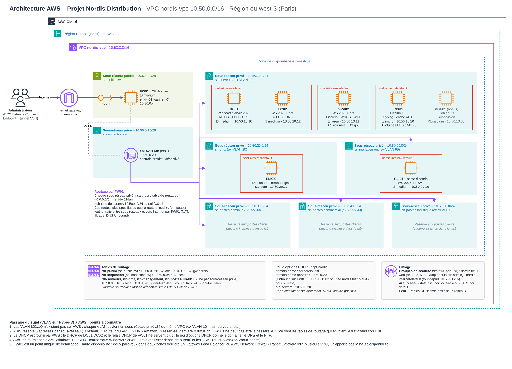

*Figure 1 — Architecture AWS : le VPC 10.50.0.0/16 et ses sous-réseaux. Tout le trafic des sous-réseaux privés passe par FW01, seule machine exposée à Internet.*

### Choix techniques (phase 0)

| Serveur | Système et mode | Justification |
| --- | --- | --- |
| FW01 | OPNsense 26.7 (base FreeBSD 15.1), interface web | Pare-feu open source maintenu. Pas d'image officielle sur AWS : conversion d'une image FreeBSD avec l'outil officiel `opnsense-bootstrap`. |
| DC01 | Windows Server 2025 Datacenter, avec bureau | Contrôleur principal, consoles locales. Support jusqu'en 2034. |
| DC02, SRV02 | Windows Server 2025, Server Core | Surface d'attaque et empreinte réduites ; administrés à distance depuis CLI01. |
| LNX01, LNX02 | Debian 13 « Trixie », sans interface | Version stable actuelle, administration SSH par clé. |
| CLI01 | Windows Server 2025, avec bureau | Poste RSAT ; Windows 11 n'est pas disponible sur EC2 sans hôte dédié. |

### Écarts avec le DAT (Hyper-V vers AWS)

| DAT d'origine | Sur AWS | Justification |
| --- | --- | --- |
| VLAN 802.1Q tagués sur FW01 | Sous-réseaux /24 routés vers FW01 | Pas de VLAN dans un VPC ; même découpage, même filtrage |
| FW01 = .1 de chaque VLAN | FW01 = 10.50.0.20 | AWS réserve le .1 de chaque sous-réseau |
| DHCP relayé par FW01 vers DC01 et DC02 | DHCP du VPC ; DHCP Windows configuré (étendues et basculement) pour la démonstration | AWS n'accepte pas d'autre serveur DHCP |
| CLI01 sous Windows 11 | Windows Server 2025 avec bureau | Pas de Windows 11 sur EC2 sans hôte dédié |
| RAM de 512 Mo à 4 Go | t3.micro à t3.large | Tailles autorisées par les droits IAM |
| Windows Admin Center sur CLI01 | Non installé | Administration par PowerShell et RSAT |
| Snapshots des VM avant chaque opération risquée | Retour arrière automatique des scripts du pare-feu ; reconstruction par Terraform et scripts | Les serveurs se recréent à l'identique depuis le code |

## TP 1 — Déploiement

Toute l'infrastructure se reconstruit depuis le code : Terraform crée le réseau et les machines, puis 15 scripts configurent les serveurs dans un ordre fixe.

### Infrastructure as Code (Terraform)

- **Réseau** : VPC `10.50.0.0/16`, un sous-réseau par zone, une table de routes par sous-réseau privé qui envoie tout vers l'interface LAN de FW01.
- **Machines** : 7 instances EC2 à IP fixe, volumes EBS gp3 chiffrés, IMDSv2 obligatoire.
- **Accès** : un EC2 Instance Connect Endpoint dans le sous-réseau Management, aucun port d'administration ouvert sur Internet.

```bash
cd tp1-infrastructure/terraform
cp terraform.tfvars.example terraform.tfvars   # clé SSH, IP publique de l'admin, image FreeBSD 15.1
terraform init && terraform plan && terraform apply
```

### Ordre de déploiement

| # | Machine | Script | Résultat |
| --- | --- | --- | --- |
| 1 | FW01 | `fw01_bootstrap.sh <IP admin>` + réglages web | OPNsense, NAT, DNS Unbound, NTP |
| 2 | DC01 | `01_DC01.ps1` (3 étapes) | Forêt, DNS, OU, groupes, audit |
| 3 | DC02 | `02_DC02.ps1` (3 étapes) | Second contrôleur, réplication |
| 4 | SRV02 | `03_SRV02.ps1` (3 étapes) | Miroir, partages, quotas |
| 5 | DC01 | `05_Utilisateurs_AD.ps1 -CheminCsv …` | Comptes et dossiers personnels |
| 6 | CLI01 | `04_CLI01.ps1` (3 étapes), puis `06_GPO.ps1` | Poste d'administration, GPO |
| 7 | DC01 | `10_DHCP.ps1` | DHCP en basculement |
| 8 | SRV02 | `09_WSUS.ps1`, `08_WEF.ps1 -Mode Collecteur`, `07_Sauvegarde.ps1 -Mode Installer` | WSUS, collecteur, sauvegarde planifiée |
| 9 | CLI01 | `08_WEF.ps1 -Mode GPO` | Sources du transfert d'événements |
| 10 | LNX01, LNX02 | `01_lnx01.sh`, `02_lnx02.sh` | Serveurs Linux |
| 11 | FW01 | `fw01_filtrage.sh` | Filtrage entre sous-réseaux, retour arrière automatique en 3 min sans confirmation |

Les scripts Windows en 3 étapes détectent seuls l'étape à faire : on les relance après chaque redémarrage. Lancement : `Set-ExecutionPolicy -Scope Process Bypass -Force ; C:\Scripts\<script>.ps1`.

### Conventions des scripts (cahier des charges, section H)

| Exigence | Mise en œuvre |
| --- | --- |
| Script documenté | En-tête : nom, auteur, date, version, description, usage, codes de retour |
| Aucune valeur en dur | Variables regroupées en tête de fichier ; mots de passe saisis à l'exécution |
| Retour d'état | Journal horodaté (`C:\Scripts\Logs`, `/var/log/nordis`), code de retour 0 (succès) ou 1 (erreur) |
| Relançable | Idempotence : ce qui existe déjà est ignoré |

### Temps et ordre de démarrage

- **Chaîne de temps** : pools NTP Internet → FW01 → DC01 (secours : Amazon Time Sync) → DC02 et membres. LNX01 se synchronise sur les DC (chrony), LNX02 sur FW01. Kerberos refuse l'authentification si l'écart dépasse quelques minutes.
- **Démarrage** : FW01, DC01 et DC02, puis 2 minutes d'attente, puis LNX01, SRV02, CLI01, LNX02. Arrêt dans l'ordre inverse.

## TP 1 — Services Windows

Les services Windows couvrent les sections A à H du cahier des charges : annuaire redondé, fichiers en miroir, GPO, WSUS, journaux centralisés et sauvegarde testée, tous déployés par script.

| Section | Exigence | Réalisation | Preuve |
| --- | --- | --- | --- |
| A | Domaine `ad.nordis.test` dans une nouvelle forêt | DC01 crée la forêt, DC02 est un second contrôleur | Figure 2 |
| A | Serveurs et poste client membres du domaine | SRV02 et CLI01 joints, rangés dans `OU=Ordinateurs` | Figure 4 |
| B | AD DS, DNS et DHCP sur les contrôleurs, redondance | Zone AD intégrée répliquée, DHCP en basculement 50/50 | Figures 2 et 3 |
| B | Fichiers par service, modèle AGDLP | 5 partages de service + dossiers personnels, droits NTFS et SMB | Figures 6 et 7 |
| C | Mot de passe strict, moindre privilège | 12 caractères, complexité, 90 jours ; compte d'administration distinct | Figure 8 |
| C | Commercial : USB et installations interdits | `GPO_Commercial_USB`, `GPO_Postes_AppLocker` | Figure 9 |
| D | Storage Spaces en miroir, quotas FSRM | Volume E: de 27 Go en miroir, 5 Go par partage, 1 Go par dossier personnel | Figure 6 |
| E | WSUS, français, produits et classifications limités | Windows Server 2025, critiques et sécurité, approbation automatique | Figure 10 |
| F | Sauvegarde planifiée, testée par une restauration | Tâche quotidienne, rétention 7 jours, restauration vérifiée | Figure 11 |
| G | Windows Event Forwarding, audit sur les DC | Abonnement `Nordis-Securite` vers SRV02, audit des connexions et des comptes | Recette, partie Recette |
| H | Script de création d'utilisateurs (CSV ou interactif) | `05_Utilisateurs_AD.ps1` | Partie Déploiement |

### Annuaire et redondance

- **Forêt** `ad.nordis.test` avec corbeille AD activée. DC01 et DC02 sont tous deux catalogues globaux.
- **Unités d'organisation** sous `OU=Nordis` : une OU par service, `Ordinateurs/Postes`, `Ordinateurs/Serveurs`, `Groupes`, `Comptes_Admin`.
- **Groupes** selon AGDLP : un groupe global par service (`Grp_<Service>`), membre de groupes locaux de domaine par ressource (`DL-<Partage>-RW` ou `-RO`), seuls titulaires des droits.
- **Comptes** : les 18 utilisateurs du fichier CSV, plus le compte d'administration nominatif `adm-t.peyrusaubes`, distinct du compte courant.

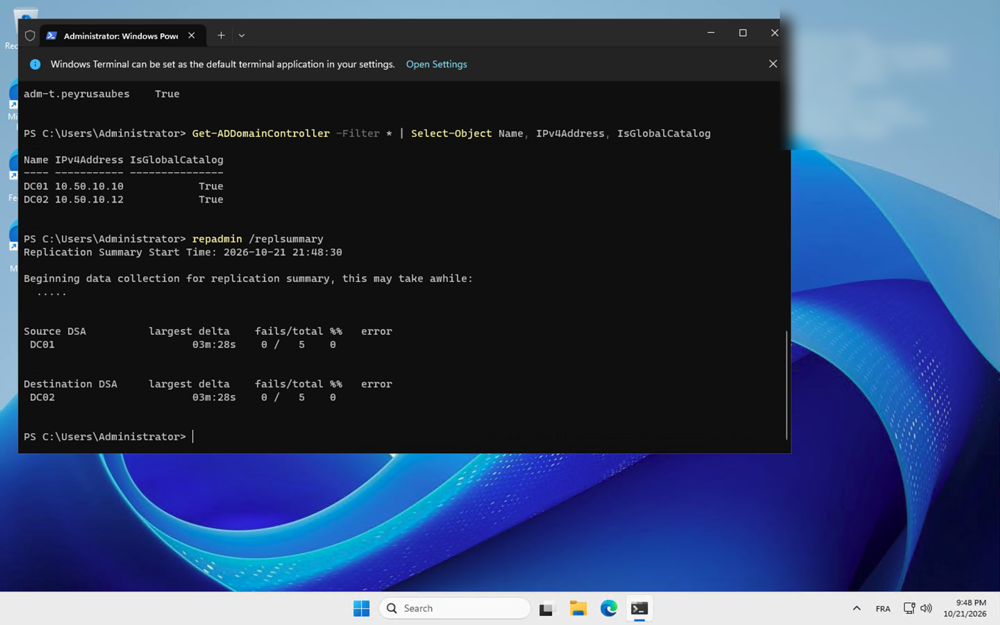

*Figure 2 — Les deux contrôleurs de domaine (10.50.10.10 et 10.50.10.12) sont catalogues globaux ; `repadmin /replsummary` : 0 échec sur 5 réplications.*

### DNS et DHCP

- **DNS** : la zone `ad.nordis.test` est intégrée à l'annuaire et répliquée sur DC02. Les DC redirigent vers Unbound (FW01) pour Internet ; Unbound renvoie la zone AD et la zone inverse `50.10.in-addr.arpa` vers DC01 et DC02.
- **DHCP** : 3 étendues (Postes Administration, Commercial, Logistique, adresses .100 à .200), bail de 8 jours, basculement DC01-DC02 en équilibrage de charge 50/50. Sur AWS, le DHCP du VPC distribue les adresses : le DHCP Windows est configuré pour la démonstration.

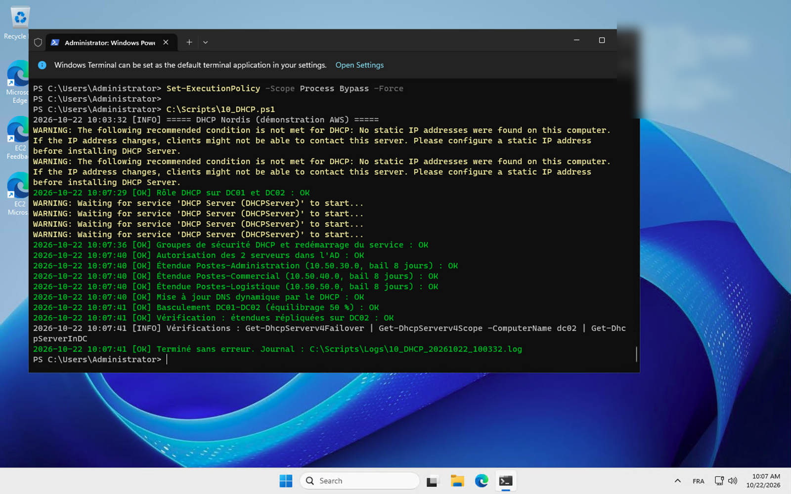

*Figure 3 — `10_DHCP.ps1` : rôle DHCP sur DC01 et DC02, autorisation dans l'AD, 3 étendues à 8 jours de bail, basculement en équilibrage 50 %.*

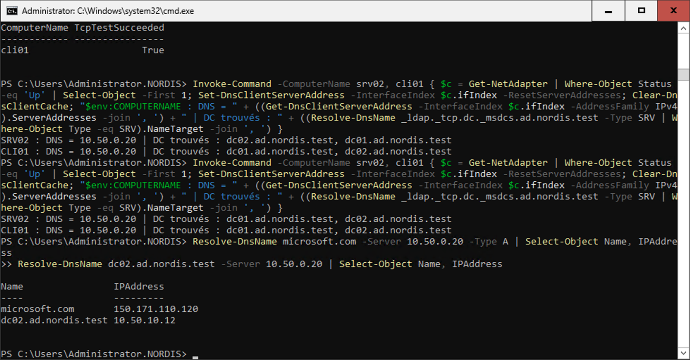

*Figure 4 — Chaîne DNS : SRV02 et CLI01 interrogent 10.50.0.20 et trouvent les deux DC ; `microsoft.com` et `dc02.ad.nordis.test` sont résolus.*

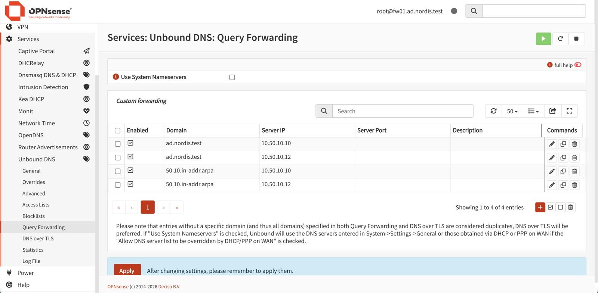

*Figure 5 — Unbound sur FW01 : `ad.nordis.test` et `50.10.in-addr.arpa` sont transmis à DC01 et DC02.*

### Fichiers, droits et quotas

- **Stockage** : un pool Storage Spaces sur 2 volumes EBS de 30 Go, en miroir, donne le volume E: (27 Go utiles).
- **Partages** : Direction, Administration, IT, Commercial, Logistique, plus `Perso$` pour les dossiers personnels. Énumération basée sur l'accès : chacun ne voit que ce qu'il peut ouvrir.
- **Droits** : NTFS et SMB portés par les groupes `DL-<Partage>-RW/RO`, jamais par un compte. La Direction accède aux 5 dossiers.
- **Quotas FSRM** : 5 Go par partage de service, 1 Go appliqué automatiquement à chaque dossier personnel.
- **Lecteurs** : le script de connexion `lecteurs.bat` (NETLOGON) monte S: à W: selon le service, H: pour le dossier personnel.

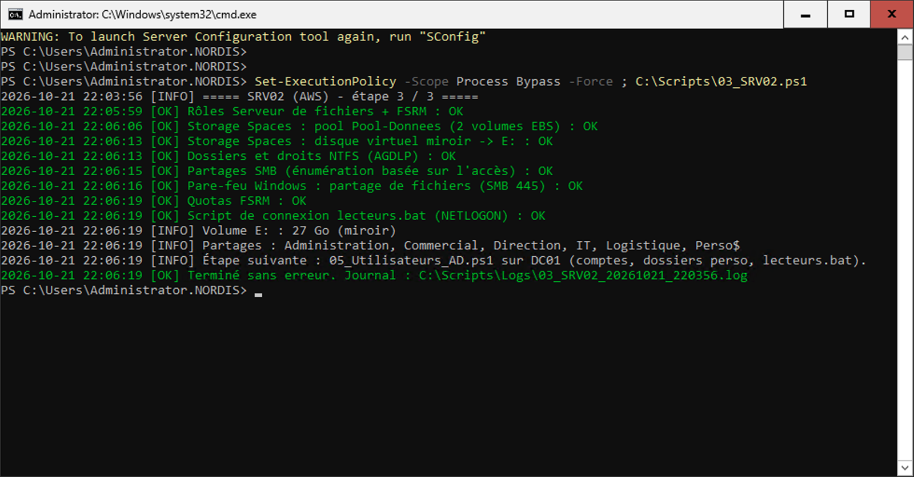

*Figure 6 — `03_SRV02.ps1`, étape 3 : rôles Fichiers et FSRM, miroir Storage Spaces (volume E:), dossiers NTFS AGDLP, partages SMB, quotas, script de connexion.*

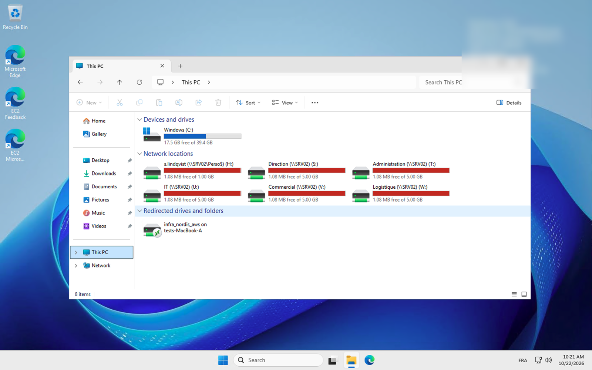

*Figure 7 — Session d'un membre de la Direction : H: et les 5 lecteurs de service (S: à W:), chacun limité à 5 Go.*

### Stratégies de groupe

| GPO | Portée | Effet |
| --- | --- | --- |
| Default Domain Policy | Domaine | Mots de passe de 12 caractères, complexité, renouvellement 90 jours, historique 24, verrouillage après 5 échecs |
| `GPO_Commercial_USB` | OU Commercial | Clés USB de stockage interdites (lecture, écriture, exécution) |
| `GPO_Postes_AppLocker` | OU Postes | `Grp_Commercial` : aucun `.exe` lancé depuis le profil ou une clé, aucun `.msi` |
| `GPO_WSUS` | Domaine | Windows Update pointe vers SRV02 (port 8530) |
| `GPO_WEF_Sources` | DC et serveurs | Adresse du collecteur WEF, lecture du journal Sécurité par le compte Service réseau |

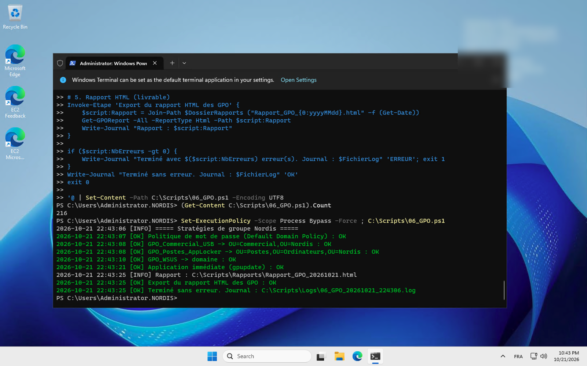

*Figure 8 — `06_GPO.ps1` : politique de mot de passe, GPO Commercial, AppLocker et WSUS créées et liées, rapport HTML exporté.*

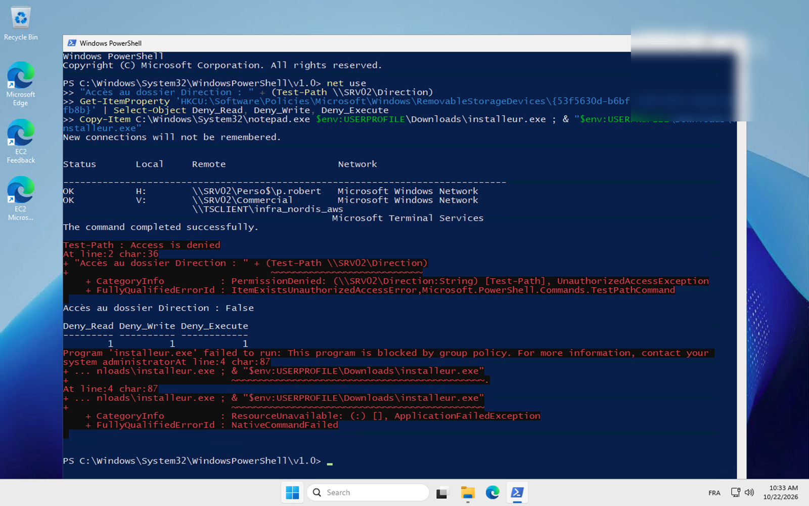

*Figure 9 — Session d'un commercial : seuls H: et V: sont montés, le dossier Direction est refusé, la stratégie USB est active et `installeur.exe` est bloqué par la stratégie de groupe.*

### Mises à jour (WSUS)

- WSUS sur SRV02 avec base interne (WID), contenu sur E:\\WSUS, port 8530.
- Produits et classifications limités : Windows Server 2025, mises à jour critiques et de sécurité, langues français et anglais (les images AWS sont en anglais).
- Synchronisation quotidienne et règle d'approbation automatique vers tous les ordinateurs.

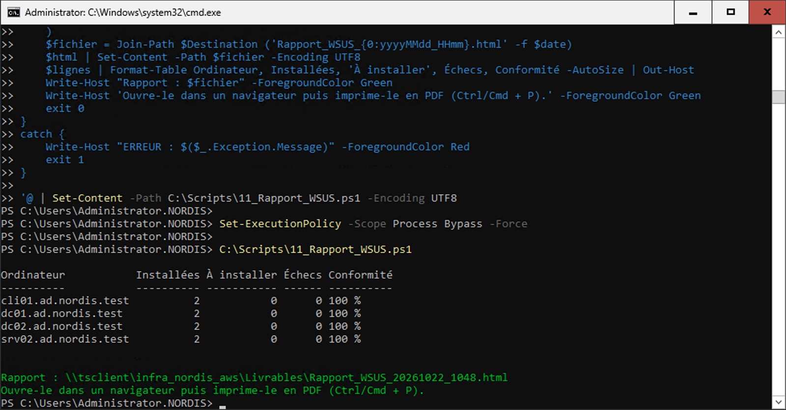

*Figure 10 — Rapport WSUS : CLI01, DC01, DC02 et SRV02 conformes à 100 %, aucun échec.*

### Journaux et audit

- **Audit** sur les DC : ouvertures de session, échecs, verrouillages, gestion des comptes et des groupes.
- **Windows Event Forwarding** : SRV02 collecte l'abonnement `Nordis-Securite` (mode initié par la source) depuis DC01, DC02 et SRV02, dans le journal « Événements transférés ».
- Événements suivis au quotidien : 4625 (échec de connexion), 4740 (compte verrouillé), 4720 (compte créé).

### Sauvegarde

- `07_Sauvegarde.ps1` copie `E:\Perso` et `E:\Partages`, droits NTFS compris, vers `E:\Sauvegardes\<date>`.
- Tâche planifiée « Nordis - Sauvegarde quotidienne » à 19 h sous le compte SYSTEM, 7 sauvegardes conservées.
- Restauration d'un élément : `07_Sauvegarde.ps1 -Mode Restaurer -Element '<chemin>'`.

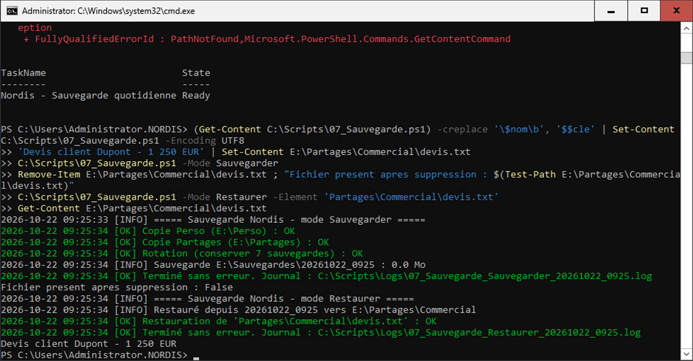

*Figure 11 — Test de restauration : un devis est créé, sauvegardé, supprimé (absent), puis restauré à l'identique.*

### Création des utilisateurs

`05_Utilisateurs_AD.ps1` crée les comptes à partir de `utilisateurs_nordis.csv` (`-CheminCsv`) ou en mode interactif (`-Interactif`) : compte dans l'OU du service, ajout au groupe du service, dossier personnel avec ses droits et son quota. Le mot de passe initial du CSV est fictif et doit être changé à la première connexion.

## TP 1 — Services Linux

LNX01 est le serveur d'infrastructure (journaux, cache de paquets, stockage redondé) intégré à l'annuaire ; LNX02 publie l'intranet en DMZ. Chacun est configuré par un seul script Bash.

| Section | Exigence | Réalisation |
| --- | --- | --- |
| A | Serveurs Linux intégrés pour l'authentification | LNX01 joint à `ad.nordis.test` (realmd, sssd) ; LNX02 reste hors domaine (DMZ) |
| B | Serveur d'infrastructure : journaux centralisés, cache de paquets | rsyslog central et apt-cacher-ng sur LNX01 |
| B | Serveur applicatif avec un service au choix | Intranet nginx sur LNX02 |
| C | sudo réservé à un groupe, SSH par clé | sudo : groupe AD `GG-Admins-Linux` ; SSH par clé, `AllowGroups` |
| D | RAID mdadm et LVM, montage par UUID | RAID 5 sur 3 disques, 3 volumes logiques montés par UUID |
| E | Dépôt de sécurité, unattended-upgrades, cache APT | `trixie-security` + unattended-upgrades ; LNX02 passe par le cache de LNX01 |
| G | Journaux centralisés côté Linux | rsyslog : LNX02 envoie ses journaux système et nginx à LNX01 |

### LNX01 : serveur d'infrastructure

- **Annuaire** : jonction par realmd et sssd. Connexion réservée aux groupes `GG-Admins-Linux` et `Grp_IT`, dossiers personnels dans `/home/AD`.
- **Stockage** : RAID 5 mdadm sur 3 volumes EBS de 10 Go (20 Go utiles), puis LVM, montages par UUID.

| Volume logique | Taille | Point de montage |
| --- | --- | --- |
| `lv_journaux` | 4 Go | `/srv/journaux` |
| `lv_home_ad` | 4 Go | `/home/AD` |
| `lv_cache_apt` | reste du groupe (12 Go) | `/var/cache/apt-cacher-ng` |

- **Journaux** : rsyslog écoute en UDP et TCP 514 et range les messages dans un dossier par hôte sous `/srv/journaux`.
- **Cache APT** : apt-cacher-ng sur le port 3142. Les dépôts Debian passent en http, seul protocole qu'il peut mettre en cache.
- **Mises à jour** : unattended-upgrades sur le dépôt `trixie-security`.
- **Heure** : chrony sur DC01 et DC02.

### LNX02 : intranet en DMZ

- **Intranet** Nordis publié par nginx sur le port 80, journal d'accès dédié.
- **Journaux** système et d'accès nginx envoyés au rsyslog de LNX01.
- **Paquets** récupérés via le cache de LNX01 (`http://10.50.10.20:3142`) : la DMZ n'a pas d'autre accès aux serveurs internes.
- **Accès** : SSH par clé, sudo local.

Le dépôt ne contient pas encore de capture des preuves Linux (`/proc/mdstat`, `lsblk`, `realm list`, dossiers de `/srv/journaux`). Les résultats figurent dans la partie Recette.

## TP 1 — Sécurité et filtrage

Trois couches se superposent pour qu'aucun flux n'échappe au pare-feu, et aucun port d'administration n'est ouvert sur Internet.

### Défense en profondeur

1. **Tables de routes AWS.** Chaque sous-réseau privé envoie `0.0.0.0/0` et les autres /24 vers l'interface LAN de FW01, par des routes plus précises que la route locale du VPC. Le contrôle source/destination est désactivé sur FW01.
2. **Groupes de sécurité.** `nordis-fw01-wan` n'accepte que 443, 22 et 51820/udp depuis l'IP de l'administrateur. `nordis-internal-default` accepte tout depuis `10.50.0.0/16`.
3. **Règles OPNsense** sur l'interface LAN (`fw01_filtrage.sh`), résumées ci-dessous.

| Ordre | Source | Destination | Ports |
| --- | --- | --- | --- |
| 10 | Management 10.50.99.0/24 | tout | tous |
| 11 | Serveurs 10.50.10.0/24 | tout | tous |
| 20–21 | Postes (30, 40, 50) | FW01 | DNS 53, NTP 123 |
| 22 | Postes | DC01, DC02 | Ports AD : 53, 88, 123, 135, 389, 445, 464, 636, 3268-3269, 9389, 49152-65535 |
| 23 | Postes | SRV02 | 445, 8530 |
| 24 | Postes | LNX02 | 80 |
| 25 | Postes | Internet (hors RFC 1918) | 80, 443 |
| 30–31 | DMZ 10.50.20.0/24 | LNX01 | 3142, 514 |
| 32–33 | DMZ | FW01 | DNS 53, NTP 123 |
| 34 | DMZ | Internet (hors RFC 1918) | 80, 443 |
| 90 | tout le reste | – | bloqué et journalisé |

La DMZ est isolée : LNX02 n'atteint que le cache APT et le rsyslog de LNX01. Sortie Internet par le NAT de FW01 (source `10.50.0.0/16` vers l'adresse WAN). Le TP 2 ajoute les règles 1 à 4, placées avant toutes celles-ci.

`fw01_filtrage.sh` sauvegarde la configuration avant d'appliquer les règles, puis revient seul en arrière au bout de 3 minutes si l'administrateur ne confirme pas. Une erreur de règle ne peut donc pas couper définitivement l'accès.

### Administration sans port exposé

L'administrateur passe par l'EC2 Instance Connect Endpoint (sous-réseau Management) jusqu'au SSH de FW01, puis par des redirections de ports vers le RDP des serveurs Windows et le SSH des serveurs Linux. Le détail est en annexe.

### Moindre privilège et données

- Droits portés par les groupes, jamais par les comptes ; compte d'administration distinct (`adm-t.peyrusaubes`) ; sudo par groupe AD.
- Postes du Commercial : clés USB interdites, aucun exécutable lancé depuis le profil ou une clé, aucun `.msi`.
- Volumes EBS chiffrés, IMDSv2 obligatoire, aucun mot de passe dans le code : ils sont saisis à l'exécution.

## TP 1 — Recette

Les 11 tests de recette sont passés : chaque fonction demandée a été vérifiée en situation, et 8 d'entre eux sont prouvés par une capture.

| Test | Méthode | Résultat | Preuve |
| --- | --- | --- | --- |
| Réplication AD | `repadmin /replsummary` | 0 échec | Figure 2 |
| DHCP en basculement | `10_DHCP.ps1`, puis `Get-DhcpServerv4Failover` | 3 étendues répliquées sur DC02, équilibrage 50/50 | Figure 3 |
| Chaîne DNS | `Resolve-DnsName` via 10.50.0.20 depuis SRV02 et CLI01 | Internet et domaine résolus, les deux DC trouvés | Figures 4 et 5 |
| Partages et quotas | `03_SRV02.ps1`, étape 3 | Miroir, partages AGDLP, quotas créés sans erreur | Figure 6 |
| Session Direction | Ouverture de session d'un membre de la Direction | 6 lecteurs : H: et S: à W: | Figure 7 |
| Session Commercial | Ouverture de session d'un commercial | H: et V: seulement, Direction refusé, USB interdit, `.exe` bloqué par AppLocker | Figure 9 |
| WSUS | `11_Rapport_WSUS.ps1` | 4 ordinateurs à 100 %, 0 échec | Figure 10 |
| Sauvegarde et restauration | Sauvegarde, suppression d'un fichier, restauration | Fichier restauré à l'identique | Figure 11 |
| Journaux Windows | Échec de connexion volontaire sur DC02 | Événement 4625 reçu sur SRV02 (Événements transférés) | – |
| Journaux Linux et intranet | Requête HTTP vers LNX02 | Intranet 200 OK, visite journalisée sur LNX01 | – |
| Isolement de la DMZ | Depuis LNX02 vers DC01, puis vers le cache APT | DC01 bloqué, cache APT autorisé | – |

Les rapports complets sont dans le dépôt : rapport HTML des GPO et rapport d'état WSUS en PDF (`tp1-infrastructure/docs/rapports`).

## TP 1 — Exploitation

L'infrastructure se démarre en deux temps, se sauvegarde chaque soir et dispose d'une procédure pour chaque panne rencontrée ou simulée.

### Démarrage et arrêt

Démarrer FW01, DC01 et DC02, attendre 2 minutes, puis le reste. Un serveur démarré avant les DC ne trouve pas le domaine (événement Netlogon 5719).

```bash
export AWS_PAGER=""   # sinon la CLI ouvre un pager « (END) » qui bloque la suite
start() { aws ec2 start-instances --region eu-west-3 --instance-ids $(aws ec2 describe-instances --region eu-west-3 \
  --filters "Name=tag:Name,Values=$1" "Name=instance-state-name,Values=stopped" \
  --query 'Reservations[].Instances[].InstanceId' --output text); }
start FW01-OPNsense,DC01,DC02 ; sleep 120 ; start LNX01,SRV02,CLI01,LNX02
```

Arrêt : `aws ec2 stop-instances` sur les mêmes noms, filtre `instance-state-name=running`. Une instance arrêtée ne coûte plus que ses disques (environ 0,45 $/h tout allumé).

### Plan de sauvegarde

| Élément | Valeur |
| --- | --- |
| Données | `E:\Perso` et `E:\Partages` (SRV02), droits NTFS compris |
| Fréquence | Chaque jour à 19 h, tâche « Nordis - Sauvegarde quotidienne » (SYSTEM) |
| Destination | `E:\Sauvegardes\<aaaammjj_hhmm>` |
| Rétention | 7 sauvegardes |
| Restauration | `07_Sauvegarde.ps1 -Mode Restaurer -Element '<chemin>' [-Sauvegarde <date>] [-Destination <dossier>]` |

### Procédures de reprise

| Panne | Symptôme | Diagnostic | Action |
| --- | --- | --- | --- |
| Disque de données plein | Lecteurs à « 1 Mo libre » | `Get-Volume E`, taille de `E:\WSUS\WsusContent` | WSUS en métadonnées seules, vider `WsusContent` |
| DC en panne | Ouvertures de session lentes | `repadmin /replsummary` | L'autre DC prend le relais ; redémarrer ou repromouvoir (`02_DC02.ps1`) |
| Compte verrouillé | « account is locked out » | Événement 4740 (journaux transférés) | `Unlock-ADAccount <login>` ou attendre 15 min |
| Serveur hors domaine au démarrage | Netlogon 5719, profil réseau « Public » | `Get-NetConnectionProfile` | Respecter l'ordre de démarrage ; `Restart-Service NlaSvc` |
| Journaux Windows non transmis | Rien dans « Événements transférés » | `wecutil gr Nordis-Securite`, événement 101 | Droit de lecture du journal Sécurité pour le Service réseau (`wevtutil sl security /ca:…`), redémarrer WinRM |
| Paquets Linux introuvables | `403 CONNECT denied` | `/etc/apt/mirrors/*.list` en https | Passer les dépôts en http ; vérifier apt-cacher-ng |
| Disque du RAID défaillant | `[UU_]` dans `/proc/mdstat` | `mdadm --detail /dev/md0` | Nouveau volume EBS, `mdadm --manage /dev/md0 --add <disque>` |
| Disque du miroir défaillant | Disque virtuel « Degraded » | `Get-VirtualDisk` | Nouveau volume, `Add-PhysicalDisk`, `Repair-VirtualDisk` |
| Fichier supprimé | Demande d'un utilisateur | Date de la dernière version | `07_Sauvegarde.ps1 -Mode Restaurer` |
| Perte d'accès à FW01 | Tunnel injoignable | Console EC2, capture d'écran série | Redémarrer ; `fw01_filtrage.sh` s'annule seul sans confirmation |

### Exploitation courante

| Fréquence | Tâche |
| --- | --- |
| Quotidienne | Journal de sauvegarde ; événements 4625, 4740, 4720 sur SRV02 ; `/srv/journaux` sur LNX01 |
| Hebdomadaire | `09_WSUS.ps1 -Mode Etat` ; `repadmin /replsummary` ; espace disque, quotas, `/proc/mdstat` |
| Arrivée ou départ | `05_Utilisateurs_AD.ps1 -Interactif` ; `Disable-ADAccount <login>` |
| Mensuelle | Test de restauration ; export du rapport des GPO |

## TP 2 — Contexte et architecture DNS

FW01 devient le seul résolveur de Nordis : les requêtes restent en clair et centralisées sur le réseau interne, mais partent chiffrées et vérifiées vers Internet, et aucun poste ne peut le contourner.

**Pourquoi ce compromis.** Chiffrer côté Internet empêche le fournisseur d'accès ou un attaquant sur le chemin de lire ou de falsifier ce que Nordis consulte. Garder le clair en interne permet de filtrer les sites interdits et de repérer un poste qui cherche à échapper à la surveillance.

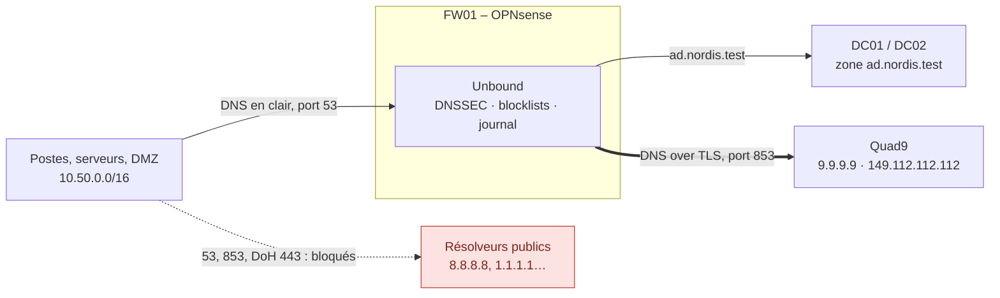

Les postes ne parlent qu'à Unbound sur FW01 ; seul Unbound sort vers Internet, en TLS vers Quad9, et tout autre résolveur est bloqué.

### Objectifs du sujet

1. Expliquer pourquoi chiffrer le DNS vers Internet mais le garder visible en interne.
2. Faire de FW01 (Unbound) le résolveur unique : DNS over TLS vers Quad9 et validation DNSSEC.
3. Router la zone `ad.nordis.test` vers DC01 et DC02, et le reste, chiffré, vers Quad9.
4. Interdire le contournement : DNS direct, DNS over TLS (DoT) direct, DNS over HTTPS (DoH).
5. Filtrer par blocklist et prouver le blocage.

### Ce qui circule où

| Segment | Ce qui circule | Pourquoi |
| --- | --- | --- |
| Poste vers FW01 (LAN) | DNS en clair, port 53 | Volontaire : c'est ce qui permet de filtrer et de journaliser |
| FW01 vers Quad9 (WAN) | DNS chiffré (TLS), port 853 | Le réseau ne voit ni les noms demandés, ni les postes |
| FW01 vers DC01 et DC02 | DNS, port 53 | La zone Active Directory reste servie par les contrôleurs |
| Poste vers Internet en direct | Bloqué (53, 853, DoH par IP) | Aucun poste ne peut éviter le résolveur de l'entreprise |

### Adaptations au contexte AWS

| Sujet du TP | Infrastructure AWS | Raison |
| --- | --- | --- |
| Résolveur `10.50.20.1` ou `10.50.10.1` | `10.50.0.20` (LAN de FW01) | Pas de VLAN dans un VPC, AWS réserve le .1 |
| DC02 = `10.50.10.11` | DC02 = `10.50.10.12` (`.11` = SRV02) | Plan d'adressage du DAT |
| Interfaces Serveurs, Postes, DMZ, Management | Interface LAN seule | Tous les sous-réseaux arrivent sur le LAN de FW01 |
| `tcpdump -i em0` | WAN = `ena0`, LAN = `ena1` | Cartes réseau AWS (pilote ENA) |
| Firefox sur CLI01 | `curl` sur LNX01 | Même mécanisme DoH, testable sans interface graphique |

## TP 2 — Configuration d'Unbound

Unbound écoute sur le LAN seulement, envoie Internet à Quad9 en DNS over TLS (port 853, certificat vérifié), valide les signatures DNSSEC et transmet la zone AD aux contrôleurs.

**Prérequis : FW01 à l'heure** (Services > Network Time). DNSSEC vérifie des signatures datées : avec une horloge fausse, toutes les réponses sont rejetées.

| Menu | Réglage | Valeur |
| --- | --- | --- |
| System > Settings > General | DNS servers | vide |
| System > Settings > General | Allow DNS server list to be overridden by DHCP/PPP on WAN | décoché |
| Services > Unbound DNS > General | Enable, Listen Port | coché, 53 |
| Services > Unbound DNS > General | Network Interfaces | LAN uniquement |
| Services > Unbound DNS > General | Enable DNSSEC Support | coché |
| Unbound DNS > Query Forwarding | Use System Nameservers | décoché |
| Unbound DNS > Query Forwarding | `ad.nordis.test` et `50.10.in-addr.arpa` | vers 10.50.10.10 et 10.50.10.12 |
| Unbound DNS > DNS over TLS | 9.9.9.9 et 149.112.112.112 | port 853, Verify CN `dns.quad9.net` |
| Unbound DNS > Advanced | Private Domains, Insecure Domains | `ad.nordis.test` |
| Unbound DNS > Advanced | Extended Statistics, Log Queries | cochés |
| Unbound DNS > Advanced | Log Level Verbosity | Level 2 |
| Reporting > Unbound DNS > Settings | Enabled | coché (journal des requêtes) |

**Point délicat — interfaces.** Le choix « All » inclut le WAN : Unbound répondrait à Internet, comme un résolveur ouvert utilisable pour des attaques par amplification. Il faut sélectionner LAN seulement.

**Point délicat — Quad9 en clair.** La configuration d'origine (TP 1) envoyait aussi les requêtes à Quad9 sur le port 53, en clair (deux dernières lignes de la figure 12). Ces lignes ont été supprimées et remplacées par les entrées DNS over TLS.

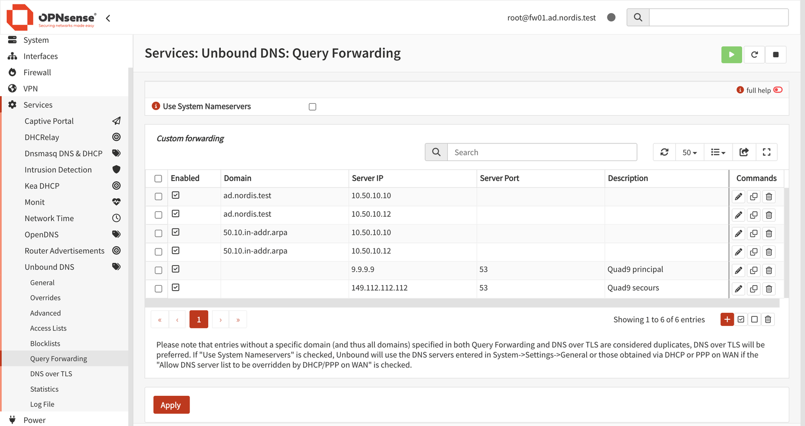

*Figure 12 — Query Forwarding avant correction : la zone AD vers les DC, mais aussi Quad9 en port 53, en clair.*

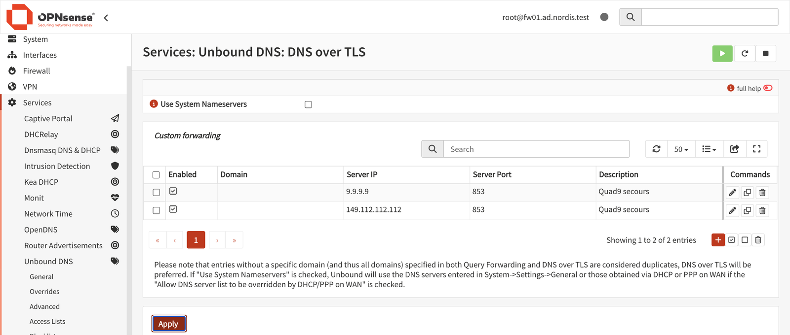

*Figure 13 — DNS over TLS : les deux serveurs Quad9 en port 853 (le premier est le principal, le second le secours).*

**Point délicat — DNSSEC et la zone AD.** Le domaine `.test` n'est pas signé. Avec DNSSEC actif, Unbound rejetterait les réponses des DC (SERVFAIL) et plus aucune ouverture de session ne fonctionnerait. `ad.nordis.test` est donc déclaré en Insecure Domains (pas de validation) et en Private Domains (adresses privées acceptées).

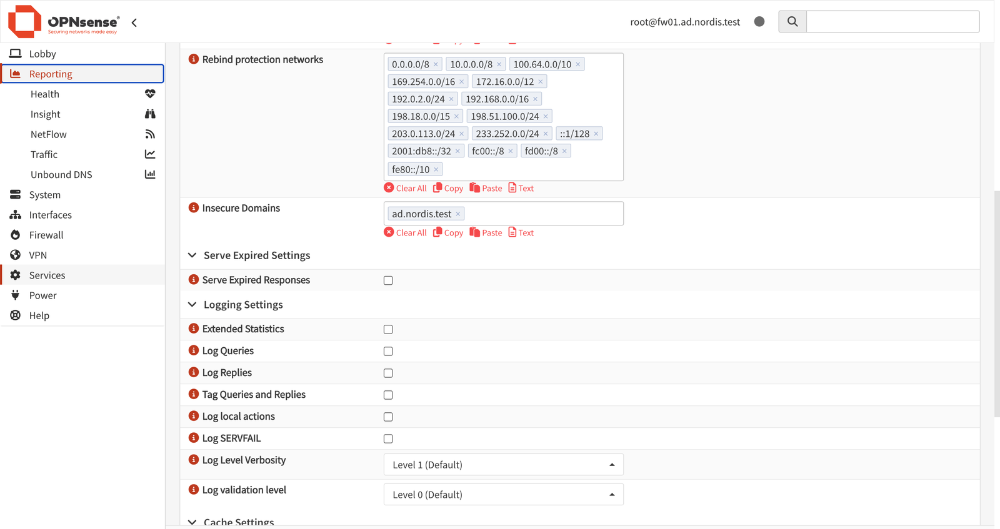

*Figure 14 — Advanced : `ad.nordis.test` en Insecure Domains, au-dessus des réglages de journalisation.*

### Vérification depuis LNX01

```bash
dig @10.50.0.20 +short txt proto.on.quad9.net   # "dot" : Quad9 reçoit bien du DNS over TLS
dig @10.50.0.20 +dnssec isc.org | grep flags     # flag ad : réponse validée par DNSSEC
dig @10.50.0.20 +short dc01.ad.nordis.test       # 10.50.10.10 : zone AD transmise aux DC
```

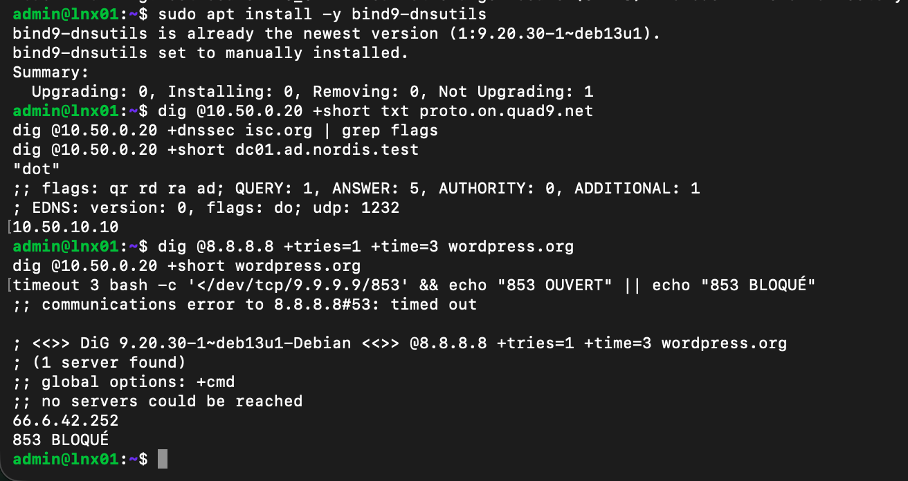

*Figure 15 — Tests depuis LNX01 : `"dot"`, flag `ad`, `10.50.10.10`, puis les tests de contournement de la partie suivante.*

## TP 2 — Interdire le contournement

Quatre règles placées avant toutes les autres obligent chaque machine à passer par Unbound : le DNS direct, le DoT direct et le DoH vers les résolveurs publics connus sont bloqués et journalisés.

Elles doivent précéder les règles 10 (Management) et 11 (Serveurs) du TP 1, qui autorisent « tout vers tout » : OPNsense applique la première règle qui correspond.

| Ordre | Action | Source | Destination | Port | Journal | Rôle |
| --- | --- | --- | --- | --- | --- | --- |
| 1 | Pass | `10.50.0.0/16` | This Firewall | 53 TCP/UDP | non | DNS vers Unbound |
| 2 | Block | `10.50.0.0/16` | hors `10.50.0.0/16` | 53 TCP/UDP | oui | DNS direct interdit |
| 3 | Block | `10.50.0.0/16` | hors `10.50.0.0/16` | 853 TCP/UDP | oui | DoT direct interdit |
| 4 | Block | `10.50.0.0/16` | alias `DoH_publics` | 443 TCP/UDP | oui | DoH par IP interdit (partie Scénario DoH) |

« Hors `10.50.0.0/16` » correspond à la case Invert Destination : la règle vise toute destination extérieure, sans gêner le DNS interne (DC, FW01).

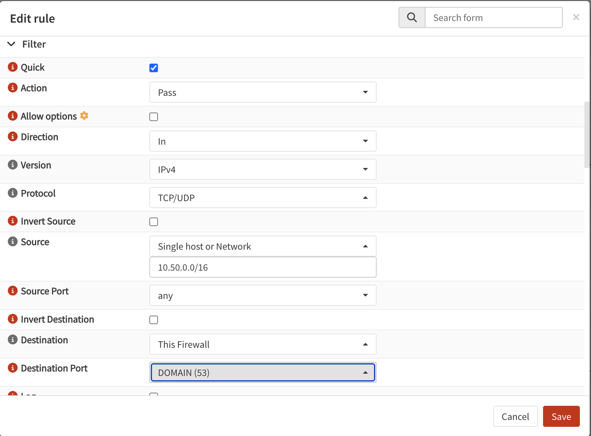

*Figure 16 — Création de la règle 1 (Firewall > Rules > LAN > +), section Filter : TCP/UDP, source 10.50.0.0/16, destination This Firewall, port 53.*

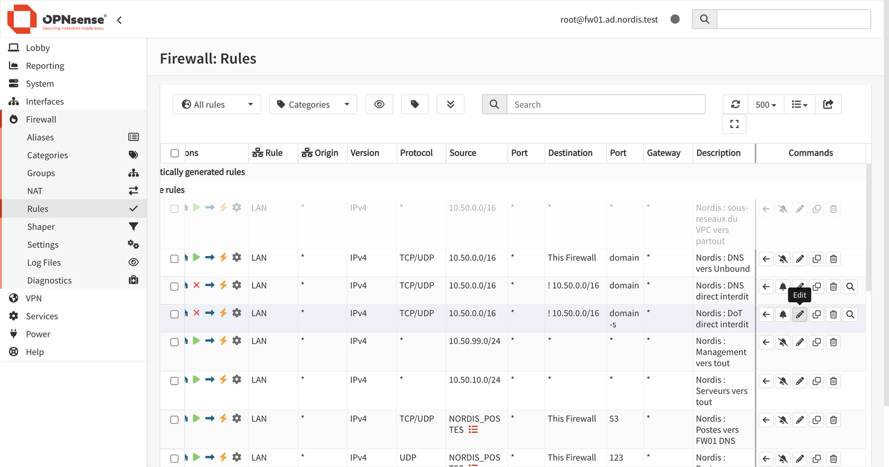

*Figure 17 — Les règles DNS en tête de la liste, avant « Management vers tout » et « Serveurs vers tout ». La croix rouge signale un blocage, la cloche une règle journalisée.*

**Point délicat — copier une règle, pas la modifier.** Pour créer une règle proche d'une autre, il faut cliquer sur l'icône copier (deux carrés), pas sur le crayon juste à côté. Pendant le TP, la règle DoT a été modifiée par erreur au lieu d'être copiée : le port 853 s'est retrouvé ouvert sans alerte, et seul un nouveau test l'a révélé (figure 31). Après chaque modification du pare-feu, on relance tous les tests.

Les règles ont été créées dans l'interface web. Le script `tp2-dns-securise/firewall/fw01_dns.sh` du dépôt les reproduit à l'identique, ignore ce qui existe déjà et revient seul en arrière au bout de 3 minutes sans confirmation.

### Tests

| Test | Commande (LNX01) | Attendu | Obtenu |
| --- | --- | --- | --- |
| DNS direct | `dig @8.8.8.8 +tries=1 +time=3 wordpress.org` | délai dépassé | `timed out` |
| DNS via FW01 | `dig @10.50.0.20 +short wordpress.org` | une adresse | `66.6.42.252` |
| DoT direct | `timeout 3 bash -c '</dev/tcp/9.9.9.9/853'` | refusé | `853 BLOQUÉ` |

Ces trois résultats figurent sur la figure 15.

## TP 2 — Preuves : clair sur le LAN, chiffré sur le WAN

Les captures `tcpdump` sur FW01 le prouvent : le WAN ne transporte que du TLS vers Quad9 sur le port 853, le LAN montre les noms en clair, et Unbound échoue plutôt que de repasser en clair.

Les captures sont lancées depuis la console de FW01 (menu, option 8). FW01 génère lui-même la requête avec `drill`, ce qui évite de jongler entre deux terminaux.

### WAN (`ena0`) : uniquement du port 853

```text
root@fw01:~ # timeout 8 tcpdump -l -ni ena0 'port 53 or port 853' & sleep 2; drill wikipedia.org @127.0.0.1 > /dev/null; wait
09:50:17.735362 IP 10.50.0.4.16899 > 9.9.9.9.853: Flags [S], ...                  length 0     <- ouverture TCP
09:50:17.736806 IP 10.50.0.4.16899 > 9.9.9.9.853: Flags [.], seq 1:1449, ...      length 1448  <- négociation TLS
09:50:17.740674 IP 10.50.0.4.16899 > 9.9.9.9.853: Flags [P.], seq 1627:1779, ...  length 152   <- question chiffrée
09:50:17.744837 IP 9.9.9.9.853 > 10.50.0.4.16899: Flags [P.], seq 4090:4891, ...  length 801   <- réponse chiffrée
24 packets captured
```

Aucune ligne en `.53`, aucun nom lisible, et seule l'adresse WAN de FW01 apparaît, jamais celle d'un poste.

### LAN, DNSSEC et absence de repli en clair

| # | Test | Résultat | Lecture |
| --- | --- | --- | --- |
| 1 | `tcpdump -ni ena1 'port 53'` + `drill lequipe.fr @10.50.10.10` | `A? lequipe.fr.` visible | Sur le LAN les noms sont lisibles, donc filtrables. Toute la chaîne apparaît : FW01 vers DC01, DC01 vers Unbound (son redirecteur), réponse signée (`RRSIG`) |
| 2 | `drill dnssec-failed.org @127.0.0.1` | `SERVFAIL` | Domaine de test volontairement mal signé : DNSSEC refuse la réponse |
| 3 | DoT passé sur le port 854, puis `tcpdump -ni ena0 'port 53'` | `0 packets captured` | Quand le DoT est cassé, Unbound échoue au lieu de repasser en clair |

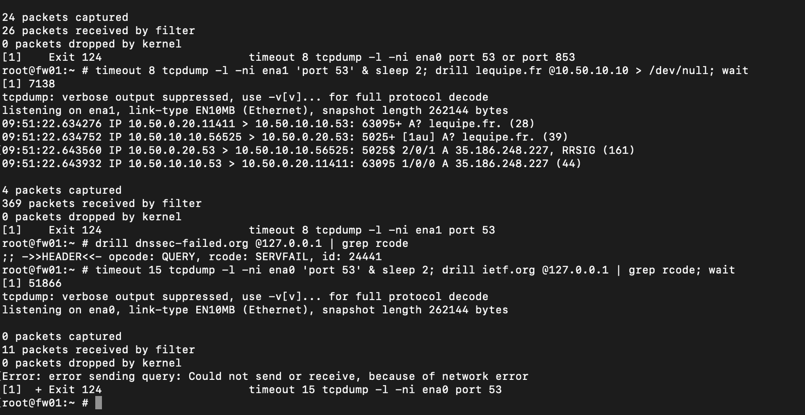

*Figure 18 — `tcpdump` sur le LAN avec le nom `lequipe.fr` en clair, `SERVFAIL` sur le domaine mal signé, puis 0 paquet en port 53 sur le WAN quand le DoT est cassé.*

**Point délicat — remettre le port 853 après le test 3.** Tant que le port reste à 854, plus rien ne se résout sur Internet, et le changement ne compte qu'après Save puis Apply. Pour vérifier ce qu'Unbound utilise réellement, sans se fier à l'interface :

```sh
grep -rh --exclude-dir=dev forward-addr /var/unbound   # doit afficher 9.9.9.9@853#dns.quad9.net
drill wordpress.com @127.0.0.1 | grep rcode            # doit afficher NOERROR
```

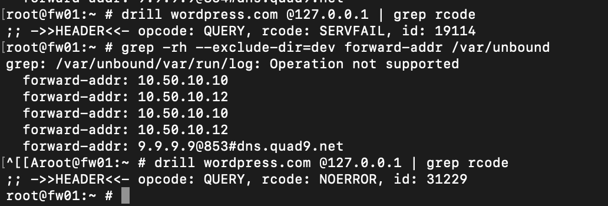

*Figure 19 — Retour au port 853 : `forward-addr` affiche `@853` et la résolution renvoie `NOERROR`.*

## TP 2 — Filtrage par blocklist

Les sites de jeux d'argent et les réseaux sociaux reçoivent l'adresse `0.0.0.0`, et chaque blocage est journalisé avec le poste, le nom demandé et la liste responsable.

**Configuration** : Services > Unbound DNS > Blocklists > +. Catégories Gambling et Social Networks (listes Hagezi), Source Net(s) vide (tous les réseaux), description « Filtrage Nordis ».

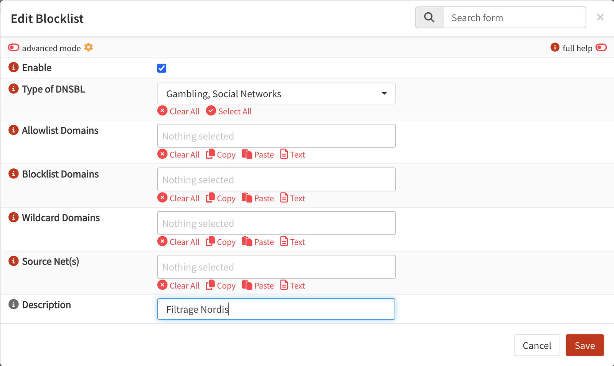

*Figure 20 — Blocklist « Filtrage Nordis » : catégories Gambling et Social Networks.*

**Pas de liste malware ou phishing.** Le sujet prévoit aussi une liste de sécurité, mais OPNsense ne la propose pas parmi les types de DNSBL de cette version. Le blocage des domaines malveillants est assuré en amont par Quad9 : le service 9.9.9.9 refuse de résoudre les domaines malveillants connus. Un flux public peut être ajouté en seconde couche (partie Limites).

### Preuves

L'onglet Tester montre la décision d'Unbound, la liste et la catégorie qui l'ont déclenchée.

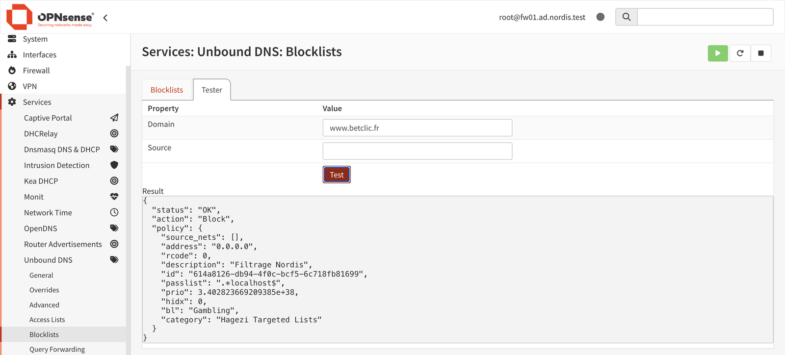

*Figure 21 — Tester : `www.betclic.fr` bloqué (`"action": "Block"`, adresse `0.0.0.0`) par la liste Gambling.*

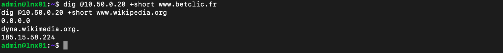

*Figure 22 — Depuis LNX01 : betclic reçoit `0.0.0.0`, Wikipédia sa vraie adresse.*

**Point délicat — journal désactivé par défaut.** Reporting > Unbound DNS affiche « Local gathering of statistics is not enabled ». Il faut cocher Enabled dans l'onglet Settings, puis refaire les tests : les requêtes antérieures ne sont pas rattrapées.

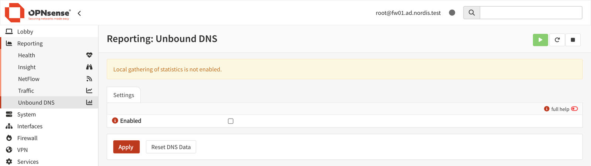

*Figure 23 — Reporting Unbound DNS avant activation du journal.*

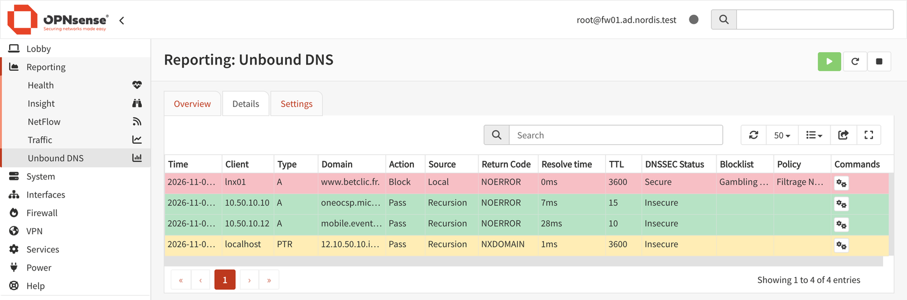

*Figure 24 — Journal après activation : le poste `lnx01`, le nom `www.betclic.fr`, l'action Block, la liste Gambling et la politique « Filtrage Nordis ».*

## TP 2 — Scénario DoH : contourner, détecter, refermer

Le DoH a permis de contourner le filtrage, mais la tentative s'est vue dans le journal, puis trois couches l'ont refermée : noms DoH bloqués, IP DoH bloquées, navigateur verrouillé.

Avec le DoH (DNS over HTTPS), une application envoie ses questions DNS chiffrées dans du HTTPS, directement à un résolveur public, sans passer par Unbound. Pour le pare-feu, c'est du trafic web ordinaire sur le port 443. Le sujet prévoit Firefox sur CLI01 ; le test a été fait avec `curl` sur LNX01, qui envoie exactement la requête d'un navigateur en mode DoH.

### 1. Contourner

```bash
dig @10.50.0.20 +short www.facebook.com     # 0.0.0.0 : bloqué par Unbound
curl -s -H 'accept: application/dns-json' \
  'https://cloudflare-dns.com/dns-query?name=www.facebook.com&type=A'   # vraie adresse : contournement réussi
```

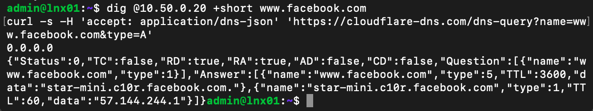

*Figure 25 — Unbound bloque facebook (`0.0.0.0`), le DoH de Cloudflare renvoie la vraie adresse (`57.144.244.1`).*

### 2. Détecter

Le DoH est chiffré, mais avant d'envoyer sa requête, le client doit trouver l'adresse du serveur DoH. Cette résolution part en clair vers Unbound et apparaît dans le journal.

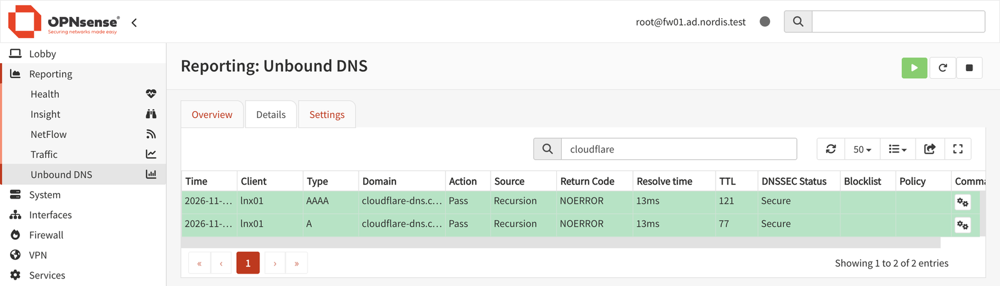

*Figure 26 — Journal Unbound : `lnx01` a demandé `cloudflare-dns.com` (types A et AAAA) juste avant de contourner le filtrage.*

| Nom observé dans le journal | Ce que ça révèle |
| --- | --- |
| `cloudflare-dns.com`, `mozilla.cloudflare-dns.com` | DoH Cloudflare (Firefox par défaut) |
| `dns.google`, `doh.opendns.com`, `dns.nextdns.io` | Autres fournisseurs DoH |
| `use-application-dns.net` | Sonde de Firefox avant d'activer seul le DoH |

### 3. Refermer

**Couche 1 : bloquer les noms DoH.** Une seconde blocklist en Wildcard Domains (le nom et tous ses sous-domaines) : `cloudflare-dns.com`, `dns.google`, `doh.opendns.com`, `dns.nextdns.io`. Ne pas y mettre `dns.quad9.net`, le résolveur de FW01.

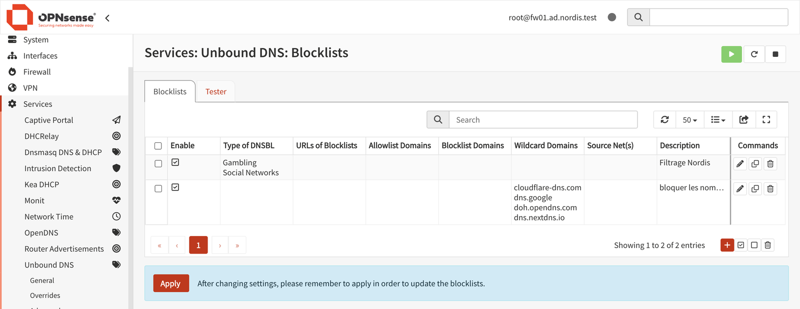

*Figure 27 — Blocklist des noms DoH en Wildcard Domains.*

`cloudflare-dns.com` répond désormais `0.0.0.0`. Mais un client qui contacte directement l'adresse IP du résolveur n'a besoin d'aucune résolution :

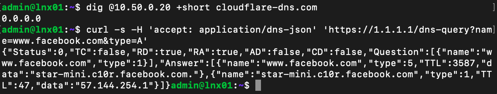

*Figure 28 — Le nom est bloqué, mais le DoH vers 1.1.1.1 fonctionne encore.*

**Couche 2 : bloquer les IP DoH.** Alias `DoH_publics` (Firewall > Aliases, type Host(s)), puis la règle 4 : blocage de `DoH_publics` en TCP et UDP 443. L'UDP couvre HTTP/3 (QUIC).

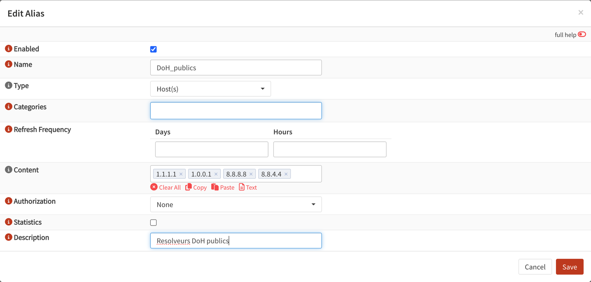

*Figure 29 — Alias `DoH_publics` : 1.1.1.1, 1.0.0.1, 8.8.8.8, 8.8.4.4.*

```bash
curl -s --max-time 5 -H 'accept: application/dns-json' \
  'https://1.1.1.1/dns-query?name=www.facebook.com&type=A' ; echo "code retour : $?"
```

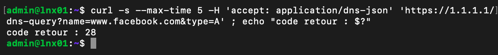

*Figure 30 — `code retour : 28` (délai dépassé) : le pare-feu jette la connexion vers 1.1.1.1.*

**Couche 3 : verrouiller le navigateur.** Le DoH est désactivé dans le navigateur, et l'utilisateur ne peut plus le réactiver. En entreprise, ce réglage se déploie par GPO ou par l'outil de gestion de parc, pas poste par poste.

| Système | Méthode | Réglage |
| --- | --- | --- |
| Linux (Firefox) | `/etc/firefox/policies/policies.json` | `{ "policies": { "DNSOverHTTPS": { "Enabled": false, "Locked": true } } }` |
| Windows (Edge, Chrome) | GPO, modèles d'administration | `DnsOverHttpsMode` = `off` |
| Windows (Firefox) | GPO, modèles Firefox | DNS over HTTPS désactivé et verrouillé |

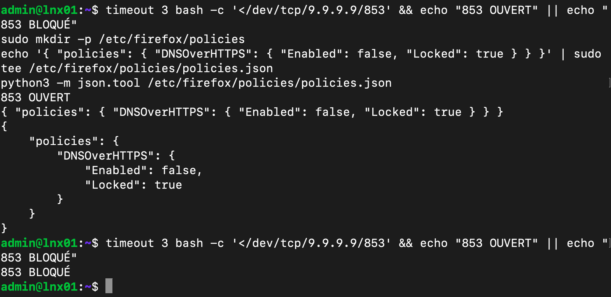

*Figure 31 — Stratégie Firefox validée sur LNX01. Le premier test affiche `853 OUVERT` (règle DoT modifiée par erreur) ; après recréation de la règle 3, le dernier affiche `853 BLOQUÉ`.*

## TP 2 — Réponses aux questions

**Question 1 — Sur la capture WAN, pourquoi ne voit-on jamais l'adresse de la machine qui a posé la question ?**

Unbound est un intermédiaire. Il reçoit la question du poste sur le LAN, puis pose lui-même une nouvelle question à Quad9 depuis sa propre adresse WAN : la requête d'origine ne sort jamais du réseau interne. Quad9 et le fournisseur d'accès ne voient donc que FW01, jamais une adresse `10.50.x.x`. Si la réponse est déjà en cache, rien ne sort du tout.

**Question 2 — Le pare-feu sait-il quelle page de betclic.fr l'utilisateur voulait voir ? Que voit-il exactement ?**

Non. Le DNS ne transporte que le nom de domaine, pas l'adresse complète de la page. Le pare-feu voit l'adresse du poste, le nom `www.betclic.fr`, le type de requête (A, AAAA), l'heure et la décision (Block), comme sur la figure 24. Le chemin de la page se trouve dans la requête HTTP, chiffrée par TLS ; ici, elle n'est même jamais envoyée, puisque la résolution a renvoyé `0.0.0.0`.

**Question 3 — Pourquoi la règle « DNS uniquement vers This Firewall » n'a-t-elle pas empêché le contournement ?**

Cette règle et les blocages associés portent sur les ports 53 (DNS) et 853 (DoT). Le DoH utilise le port 443, celui du web, qui doit rester ouvert pour la navigation. Sans déchiffrement TLS, le pare-feu ne peut pas distinguer une requête DoH d'une page web ordinaire.

**Question 4 — Pourquoi bloquer un nom de domaine dans Unbound suffit-il à casser le DoH, alors que les requêtes DoH sont chiffrées ?**

Avant d'ouvrir la moindre connexion chiffrée, le client doit connaître l'adresse IP du serveur DoH, et cette résolution part en clair vers Unbound. Si Unbound répond `0.0.0.0`, la connexion HTTPS ne s'établit pas et le tunnel chiffré n'existe jamais. Le navigateur revient alors au DNS système, donc à Unbound et à ses filtres, ou échoue. Limite : un client qui contacte directement une IP (1.1.1.1) n'a besoin d'aucune résolution, d'où le blocage complémentaire des IP DoH.

## Points délicats rencontrés

Voici les problèmes rencontrés pendant les deux TP. Chacun est documenté avec son symptôme, sa cause et sa solution, pour ne pas le revivre.

### TP 1

| Problème | Symptôme | Cause | Solution |
| --- | --- | --- | --- |
| Pas d'OPNsense sur AWS | Aucune image officielle | Éditeur absent de la place de marché | Instance FreeBSD 15.1 convertie par `opnsense-bootstrap` (`fw01_bootstrap.sh`) |
| Serveur hors domaine au démarrage | Netlogon 5719, profil réseau « Public » | Serveur démarré avant les DC | Ordre de démarrage fixe : FW01, DC, puis le reste |
| CLI01 reste en profil « Public » | Pare-feu Windows du profil Domaine inactif | Comportement connu sur EC2 | Règle WinRM du profil Public limitée à `10.50.0.0/16` |
| Mots de passe du CSV refusés | Création des comptes en erreur | La politique passe à 12 caractères, le mot de passe initial en fait 11 | `05_Utilisateurs_AD.ps1` lancé avant `06_GPO.ps1` |
| Mot de passe collé refusé | Mot de passe jugé incorrect | Espaces invisibles ajoutés par le copier-coller | Les scripts retirent ces caractères avant usage |
| Volume E: saturé | Lecteurs à « 1 Mo libre » | Contenu des mises à jour WSUS téléchargé sur le volume de données | WSUS en métadonnées seules, `WsusContent` vidé |
| Journaux Windows non transférés | « Événements transférés » vide | Le Service réseau ne peut pas lire le journal Sécurité | Droit de lecture ajouté par `GPO_WEF_Sources` |
| Paquets Linux introuvables | `403 CONNECT denied` | apt-cacher-ng ne relaie pas le https | Dépôts Debian passés en http |

### TP 2

| Problème | Symptôme | Cause | Solution |
| --- | --- | --- | --- |
| Zone AD et DNSSEC | Risque de `SERVFAIL` sur `*.ad.nordis.test` | `.test` n'est pas signé | `ad.nordis.test` en Insecure Domains et Private Domains |
| Quad9 en clair | Requêtes en port 53 sur le WAN | Anciennes lignes de Query Forwarding | Supprimées, remplacées par DNS over TLS |
| Règle modifiée au lieu d'être copiée | `853 OUVERT` sans alerte | Clic sur le crayon au lieu de l'icône copier | Règle recréée ; tous les tests relancés après chaque changement |
| Test de non-repli | `SERVFAIL` persistant après retour à 853 | Changement non appliqué (Save sans Apply) | `forward-addr` vérifié dans `/var/unbound`, puis Save et Apply |
| Journal vide | « Local gathering of statistics is not enabled » | Option désactivée par défaut | Reporting > Unbound DNS > Settings > Enabled |
| `drill` échoue au premier essai | `Could not send or receive` | Délai de `drill` plus court que celui d'Unbound | Relancer ; le `0 packets` de `tcpdump` suffit comme preuve |
| Commandes shell sur FW01 | `grep: 2: No such file or directory` | Le shell root d'OPNsense est `csh` : `2>/dev/null` n'existe pas | Ne pas rediriger, ou passer par `sh -c '…'` |
| `grep -r` bloqué sur FW01 | La commande ne rend plus la main | `/var/unbound` contient un `dev/` monté (chroot) | `grep -r --exclude-dir=dev` |
| Interfaces dans `tcpdump` | `em0` introuvable | Cartes réseau AWS (ENA) | WAN = `ena0`, LAN = `ena1` |

### Accès d'administration

| Problème | Symptôme | Cause | Solution |
| --- | --- | --- | --- |
| Tunnel coupé | `TypeError: 'NoneType' object is not iterable` | La CLI AWS plante quand la connexion WebSocket du tunnel est coupée | Script d'accès avec reconnexion automatique (annexe) |
| Tunnel refusé | `AccessDeniedException … OpenTunnel` | Sans `--max-tunnel-duration`, la politique IAM refuse ; avec, elle accepte | Toujours passer `--max-tunnel-duration 3600` |
| Poste d'administration sans accès à AWS | `Could not resolve host` alors que `nslookup` répond | Résolveur système du Mac bloqué | Vider le cache DNS du Mac, couper et rallumer le Wi-Fi |
| Commande AWS bloquée | Affichage « (END) » | Pager de la CLI AWS | `export AWS_PAGER=""` |

## Limites et améliorations

L'infrastructure répond au cahier des charges, mais elle reste un environnement de formation : FW01 est un point unique de défaillance et la sauvegarde partage le volume des données.

| TP | Limite | Amélioration proposée |
| --- | --- | --- |
| 1 | FW01 est un point unique de défaillance (une seule zone de disponibilité) | Deux pare-feux dans deux zones derrière un Gateway Load Balancer, ou AWS Network Firewall |
| 1 | La sauvegarde est sur le même volume que les données | Instantanés EBS quotidiens (AWS Data Lifecycle Manager), copie hors du compte |
| 1 | Supervision MON01 (bonus, Zabbix) non réalisée | Déployer Zabbix sur 10.50.10.30 : disponibilité, disques, réplication AD |
| 1 | DHCP Windows configuré mais non utilisé (AWS impose son DHCP) | Sur une infrastructure physique : relais DHCP sur FW01 vers DC01 et DC02, comme prévu par le DAT |
| 1 | Windows Admin Center non installé | L'installer sur CLI01 pour une administration graphique centralisée |
| 2 | Pas de liste malware locale : OPNsense ne la propose pas dans cette version | Quad9 bloque déjà les domaines malveillants ; en seconde couche, ajouter un flux public (URLhaus d'abuse.ch) en URLs of Blocklists |
| 2 | L'alias `DoH_publics` ne couvre que 4 adresses | Alias de type URL Table alimenté par une liste publique d'IP DoH, mise à jour chaque jour |
| 2 | La détection du DoH demande de lire le journal à la main | Envoyer les journaux d'Unbound vers le rsyslog de LNX01 et alerter sur les noms de résolveurs DoH |
| 2 | Le DoH vers un serveur privé (IP et nom inconnus) reste possible | Inspection TLS (SNI) ou proxy web obligatoire |
| 2 | Configuration d'Unbound faite dans l'interface web | Historisée par OPNsense (`/conf/backup`) ; les règles sont versionnées dans `fw01_dns.sh` |

## Annexes

### A. Accès d'administration

Aucun port d'administration n'est ouvert sur Internet. Un seul script, lancé depuis le poste de l'administrateur, ouvre le tunnel AWS, pose toutes les redirections et se reconnecte seul après une coupure.

```bash
outils/nordis-tunnel.sh      # laisser tourner, Ctrl+C pour arrêter
```

| Machine | Accès |
| --- | --- |
| FW01 | `https://localhost:8443`, `ssh -i ~/.ssh/nordis.pem -p 2222 root@127.0.0.1` |
| DC01, DC02, SRV02, CLI01 | RDP sur `127.0.0.1` : ports 13389, 33389, 43389, 23389 |
| LNX01, LNX02 | `ssh -i ~/.ssh/nordis.pem -p 2201 admin@127.0.0.1`, port 2202 pour LNX02 |

### B. Organisation du dépôt GitHub

```text
nordis-infra-aws/
├── DOCUMENTATION.md       ce document, en version Markdown
├── tp1-infrastructure/    TP 1 – Infrastructure hybride
│   ├── terraform/           VPC, routes, groupes de sécurité, instances, disques
│   ├── firewall/            installation d'OPNsense, filtrage entre sous-réseaux
│   ├── scripts/             windows/ (PowerShell), linux/ (Bash)
│   └── docs/                architecture, exploitation, captures, rapports GPO et WSUS
├── tp2-dns-securise/      TP 2 – DNS maîtrisé
│   ├── firewall/            règles anti-contournement (fw01_dns.sh)
│   ├── navigateur/          stratégie Firefox (DoH désactivé)
│   └── captures/            preuves du compte rendu
└── outils/
    └── nordis-tunnel.sh     accès d'administration, commun aux deux TP
```

### C. Comptes

Aucun mot de passe n'est stocké dans le dépôt : ils sont saisis à l'exécution des scripts et conservés dans un gestionnaire de mots de passe.

| Compte | Usage |
| --- | --- |
| `NORDIS\Administrator` | Administration du domaine, interventions exceptionnelles |
| `NORDIS\adm-t.peyrusaubes` | Compte d'administration nominatif (Admins du domaine, `GG-Admins-Linux`) |
| DSRM DC01, DC02 | Restauration des services d'annuaire |
| `root` (FW01) | OPNsense |
| `admin` (LNX01, LNX02) | Compte local Debian, clé SSH |
