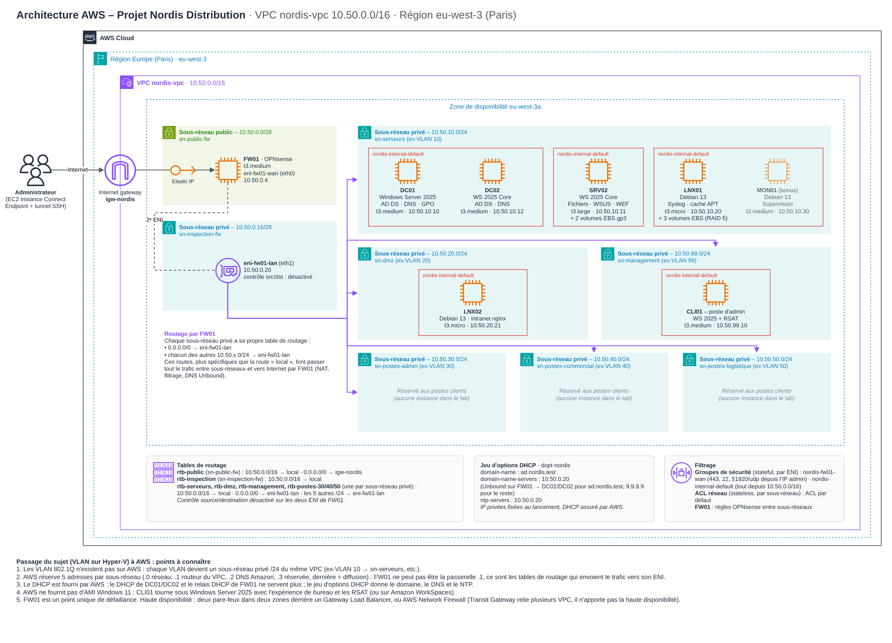
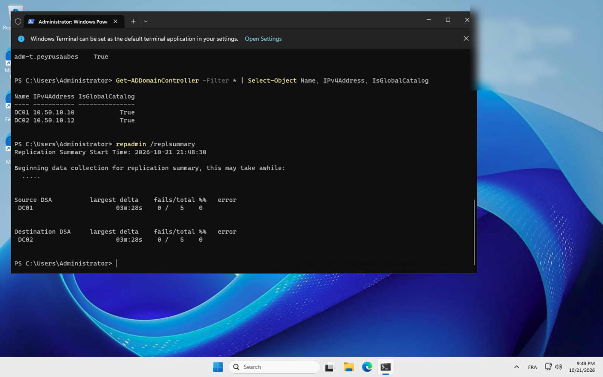
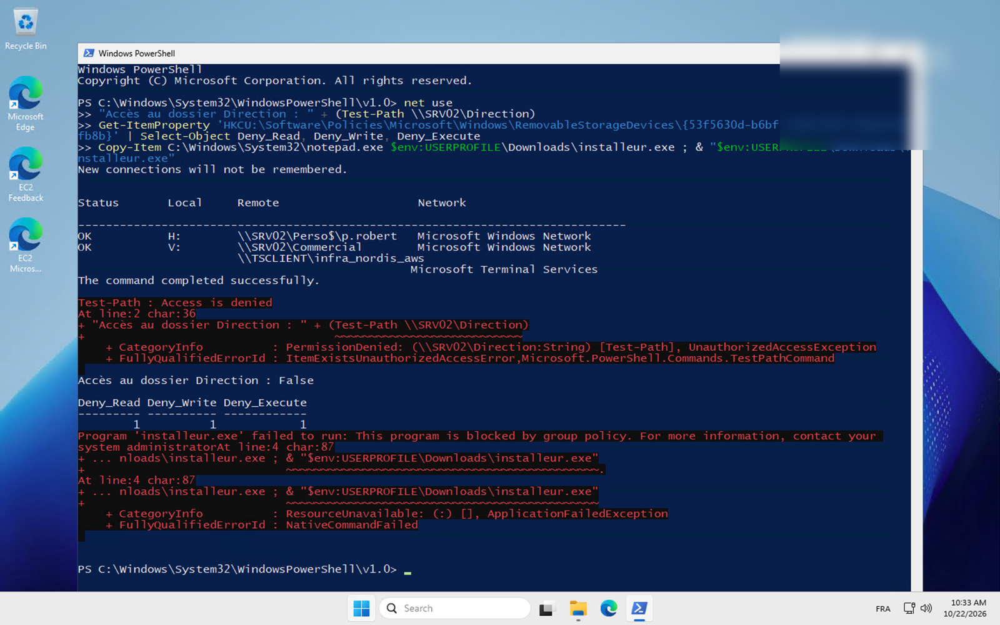
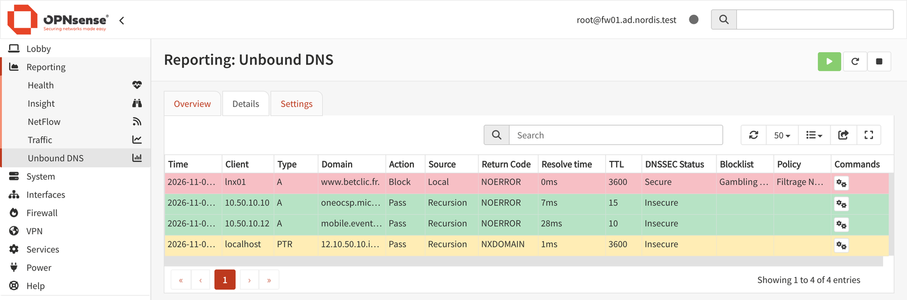
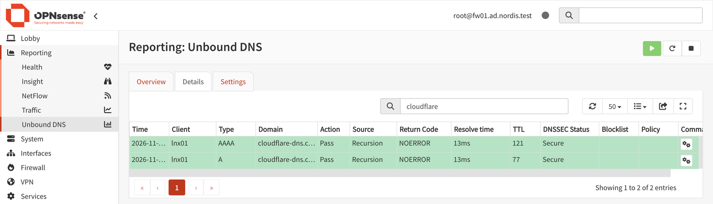

# Nordis Distribution – Hybrid Windows / Linux Infrastructure on AWS


🇫🇷 [Version française](README.fr.md)

The complete IT system of a fictional 80-employee company, **built** and then **secured** on AWS, as two practical projects of my Bachelor's year 3 in Infrastructure & Cybersecurity. The detailed reports and documentation are in French.

> **[Full technical documentation for both projects](DOCUMENTATION.md)** (French): the operations handbook required by the specification, with every requirement linked to its implementation and its proof, and 36 screenshots.



## The two projects

| | [Project 1 – Hybrid infrastructure](tp1-infrastructure/README.md) | [Project 2 – Controlled DNS](tp2-dns-securise/README.md) |
| --- | --- | --- |
| **Goal** | Deploy the whole IT system as code: network, directory, file sharing, updates, logs, backup | Make the firewall the only DNS resolver: encrypted to the Internet, visible internally, impossible to bypass |
| **Delivered** | 7 EC2 instances with Terraform, redundant Active Directory, GPOs, WSUS, WEF, rsyslog, RAID, tested backup, OPNsense firewall | DNS over TLS to Quad9, DNSSEC, logged blocklists, direct DNS / DoT / DoH blocked, DoH attack scenario |
| **Deliverables** | Terraform, PowerShell and Bash scripts, architecture document, operations handbook | Report with 20 screenshots, anti-bypass firewall rules script, browser policy |
| **Period** | October 2026 | November 2026 |

### Project 1 – Hybrid Windows / Linux infrastructure as code

- **Everything is code**: VPC, routes, security groups and instances with Terraform; every server configured by a re-runnable script with logging and exit codes (18 PowerShell and Bash scripts).
- **All traffic goes through the firewall**: every private subnet (`10.50.0.0/16`: servers, DMZ, users, management) routes to an OPNsense firewall that handles NAT, DNS, NTP and inter-subnet filtering.
- **No administration port exposed to the Internet**: access only through an EC2 Instance Connect Endpoint and an SSH tunnel.
- **Services**: 2 domain controllers with DNS and DHCP failover, GPOs, AGDLP access model, file server with quotas, WSUS, centralized logs (Windows Event Forwarding, rsyslog), RAID 5 + LVM on Linux, Linux joined to the domain, backup and restore tested.

| | |
| --- | --- |
|  |  |

→ [Project 1 report](tp1-infrastructure/README.md) · [Architecture](tp1-infrastructure/docs/architecture.md) · [Operations](tp1-infrastructure/docs/exploitation.md)

### Project 2 – Controlled DNS: encryption, filtering, bypass detection

- **Encrypted to the Internet, readable inside**: the WAN only carries TLS to Quad9 with DNSSEC validation, while the LAN stays readable so queries can be filtered and logged.
- **Filtering and traceability**: gambling and social networks blocked, every query logged with the requesting host.
- **Bypass attempts demonstrated, detected and blocked**: direct DNS, direct DNS over TLS, and DNS over HTTPS by name and by IP, plus a locked browser policy.

| | |
| --- | --- |
|  |  |

→ [Project 2 report](tp2-dns-securise/README.md)

## Repository layout

```
.
├── DOCUMENTATION.md       Full technical documentation for both projects
├── tp1-infrastructure/    Project 1 – Hybrid infrastructure
│   ├── terraform/           VPC, routes, security groups, instances, disks
│   ├── firewall/            OPNsense: bootstrap, inter-subnet filtering
│   ├── scripts/             windows/ (PowerShell), linux/ (Bash)
│   └── docs/                architecture, operations, screenshots, GPO and WSUS reports
├── tp2-dns-securise/      Project 2 – Controlled DNS
│   ├── firewall/            anti-bypass rules for DNS / DoT / DoH
│   ├── navigateur/          Firefox policy (DoH disabled)
│   └── captures/            evidence for the report
└── outils/                Shared tooling
    └── nordis-tunnel.sh     admin access tunnel with automatic reconnection
```

## Administration access

No administration port is open to the Internet: access goes through an EC2 Instance Connect Endpoint, then through the firewall's SSH.

```bash
outils/nordis-tunnel.sh      # tunnel + port forwards, reconnects on its own; Ctrl+C to stop
```

| Machine | Access |
| --- | --- |
| FW01 | https://localhost:8443 · `ssh -i ~/.ssh/nordis.pem -p 2222 root@127.0.0.1` |
| DC01 · DC02 · SRV02 · CLI01 | RDP `127.0.0.1:13389` · `33389` · `43389` · `23389` |
| LNX01 · LNX02 | `ssh -i ~/.ssh/nordis.pem -p 2201 admin@127.0.0.1` · `-p 2202` |

Start, stop and recovery procedures: [operations handbook](tp1-infrastructure/docs/exploitation.md) (French).

## Confidentiality

- No secrets in the repository: Terraform state, local variables and keys are excluded by `.gitignore`; passwords are typed when the scripts run.
- Screenshots are cropped: no browser tabs, no public IP address, no AWS account ID.

## Stack

AWS · Terraform · OPNsense · Windows Server 2025 · Active Directory · PowerShell · Debian · Bash · Unbound · nginx

---

**Author**: Thomas Peyrusaubes · Bachelor 3 Infrastructure & Cybersecurity · October – November 2026
