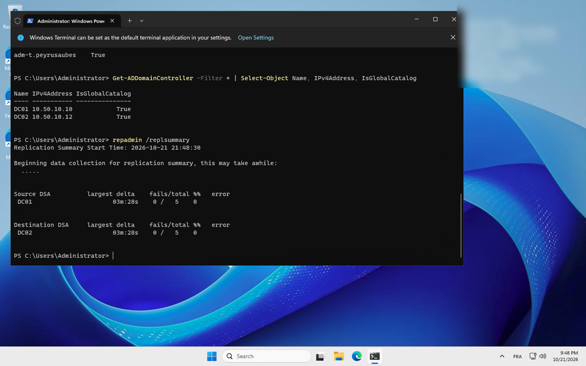
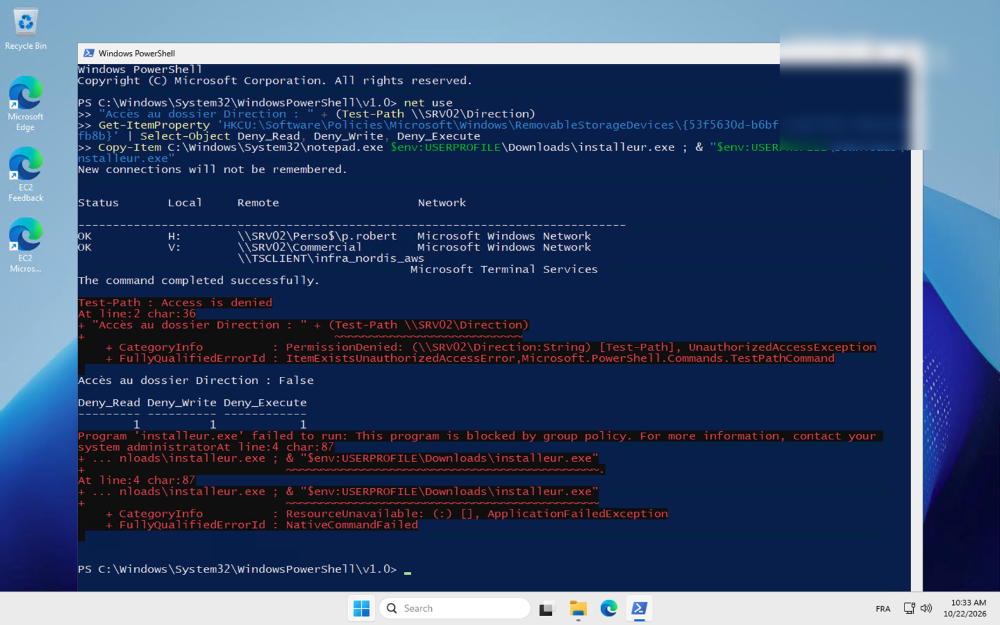
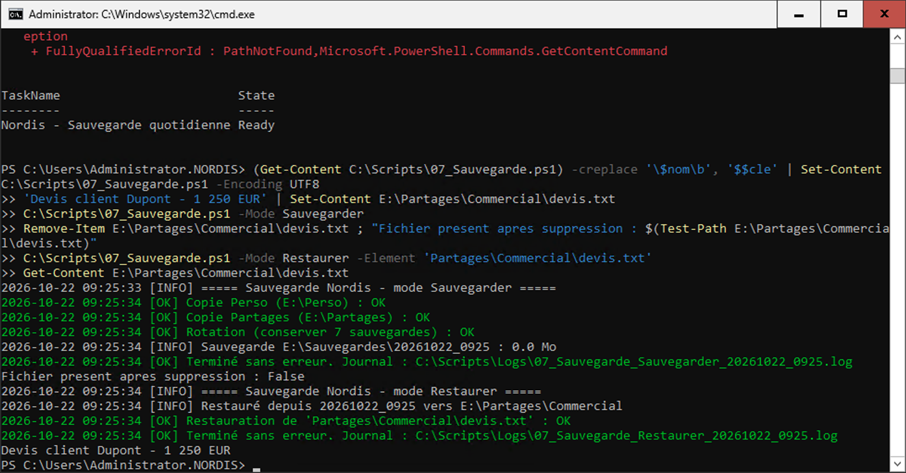
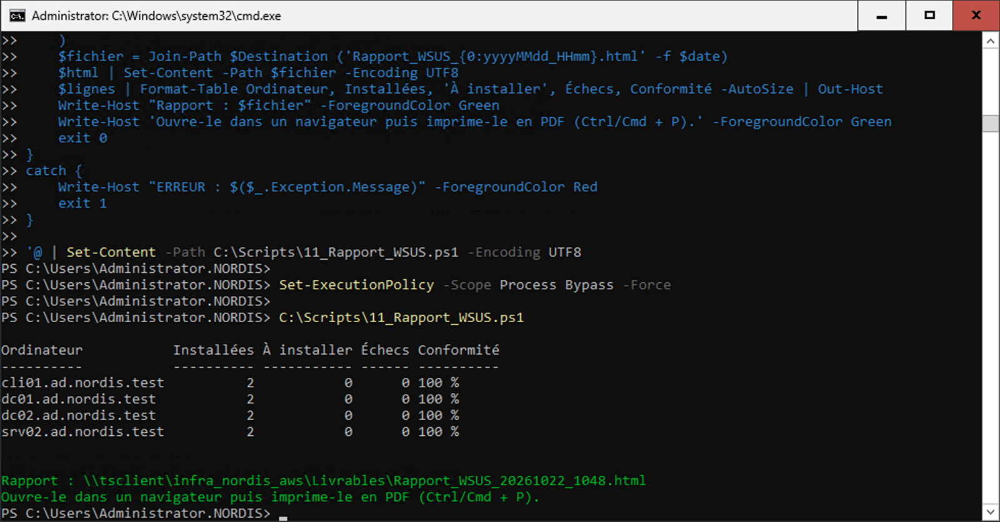

# Nordis Distribution – Infrastructure hybride Windows / Linux sur AWS


Infrastructure complète d'une PME de 80 salariés, déployée sur AWS en **Infrastructure as Code** et configurée **entièrement par scripts** : domaine Active Directory redondé, serveur de fichiers, mises à jour centralisées, journaux centralisés, sauvegarde testée, serveurs Linux intégrés à l'annuaire, le tout derrière un pare-feu OPNsense.

> Projet fil rouge du Bachelor 3 Infrastructure & Cybersécurité (module A2627_5066 – Administration systèmes Linux/Windows). Le cahier des charges prévoyait des VM Hyper-V ; l'infrastructure a été transposée sur AWS.


## Sommaire

- [Points clés](#points-clés)
- [Architecture](#architecture)
- [Services déployés](#services-déployés)
- [Structure du dépôt](#structure-du-dépôt)
- [Déploiement](#déploiement)
- [Sécurité](#sécurité)
- [Recette](#recette)
- [Adaptations Hyper-V → AWS](#adaptations-hyper-v--aws)
- [Documentation](#documentation)

## Points clés

- **7 instances EC2** (Windows Server 2025, Debian 13, OPNsense) dans un VPC `10.50.0.0/16`, créées par **Terraform**.
- **Tout le trafic passe par le pare-feu** : chaque sous-réseau privé route vers FW01, qui assure NAT, DNS, NTP et filtrage.
- **Aucun port d'administration exposé sur Internet** : accès par EC2 Instance Connect Endpoint + tunnel SSH.
- **18 scripts** PowerShell et Bash documentés, relançables, avec journal et code de retour.
- **Chaque compétence prouvée sur les deux OS** : services, droits, journaux, mises à jour, stockage redondé.

## Architecture

| Machine | Rôle | Système | IP | Sous-réseau |
| --- | --- | --- | --- | --- |
| FW01 | Pare-feu, routage, NAT, DNS (Unbound), NTP | OPNsense 26.7 | 10.50.0.4 (WAN) · 10.50.0.20 (LAN) | public + inspection |
| DC01 | AD DS, DNS, DHCP (principal) | Windows Server 2025 | 10.50.10.10 | Serveurs |
| DC02 | AD DS, DNS, DHCP (partenaire) | Windows Server 2025 Core | 10.50.10.12 | Serveurs |
| SRV02 | Fichiers, FSRM, WSUS, collecteur WEF, sauvegarde | Windows Server 2025 Core | 10.50.10.11 | Serveurs |
| LNX01 | rsyslog central, cache APT, RAID 5 + LVM, intégré à l'AD | Debian 13 | 10.50.10.20 | Serveurs |
| LNX02 | Intranet nginx | Debian 13 | 10.50.20.21 | DMZ |
| CLI01 | Poste d'administration (RSAT) | Windows Server 2025 | 10.50.99.10 | Management |

| Sous-réseau | Plage | Équivalent VLAN |
| --- | --- | --- |
| Serveurs | 10.50.10.0/24 | VLAN 10 |
| DMZ | 10.50.20.0/24 | VLAN 20 |
| Postes Administration / Commercial / Logistique | 10.50.30-50.0/24 | VLAN 30, 40, 50 |
| Management | 10.50.99.0/24 | VLAN 99 |
| FW01 WAN / LAN | 10.50.0.0/28 · 10.50.0.16/28 | – |

**Flux** : Internet ↔ FW01 (seule IP publique) ↔ sous-réseaux privés. DNS : tous les hôtes → FW01 → DC pour `ad.nordis.test`, Quad9 pour le reste. Heure : Internet → FW01 → DC01/DC02 → membres.

## Services déployés

| Domaine | Windows | Linux |
| --- | --- | --- |
| Annuaire | Forêt `ad.nordis.test`, 2 DC (catalogue global), OU par service, 18 comptes | LNX01 joint au domaine (realmd / sssd) |
| Droits | Modèle AGDLP : `Grp_<Service>` → `DL-<Partage>-RW/RO` → NTFS + SMB | `sudo` réservé au groupe AD `GG-Admins-Linux`, SSH par clé |
| Stockage | Storage Spaces en miroir, quotas FSRM (5 Go / partage, 1 Go / utilisateur) | RAID 5 mdadm + LVM, montage par UUID |
| Partages | 5 partages de service + dossiers perso, lecteurs S: à W: et H: | Intranet nginx (DMZ) |
| GPO | Mots de passe 12 car., USB et AppLocker pour le Commercial, WSUS, WEF | – |
| Mises à jour | WSUS (Windows Server 2025, critiques + sécurité, approbation auto) | unattended-upgrades + cache apt-cacher-ng |
| Journaux | Windows Event Forwarding vers SRV02, audit des connexions | rsyslog central sur LNX01 |
| Sauvegarde | Tâche planifiée quotidienne, rétention 7 jours, restauration testée | – |
| Réseau | DHCP en basculement 50/50 DC01-DC02 | – |

## Structure du dépôt

```
.
├── terraform/            Infrastructure AWS (VPC, routes, groupes de sécurité, instances, disques)
├── firewall/             fw01_bootstrap.sh (FreeBSD → OPNsense), fw01_filtrage.sh (règles du DAT)
├── scripts/
│   ├── windows/          01_DC01 … 11_Rapport_WSUS (PowerShell) + utilisateurs_nordis.csv
│   └── linux/            01_lnx01.sh, 02_lnx02.sh (Bash)
└── docs/
    ├── architecture-aws.(png|drawio)
    ├── architecture.md   Document d'architecture technique
    ├── exploitation.md   Démarrage, sauvegarde, procédures de reprise
    ├── captures/         Preuves de recette
    └── rapports/         Rapport des GPO (HTML), rapport d'état WSUS (PDF)
```

## Déploiement

**Prérequis** : Terraform ≥ 1.0, AWS CLI configurée (région `eu-west-3`), une paire de clés EC2.

```bash
cd terraform
cp terraform.tfvars.example terraform.tfvars   # clé SSH, IP publique de l'admin, image FreeBSD 15.1
terraform init && terraform plan && terraform apply
```

Puis, dans l'ordre :

| # | Machine | Script | Résultat |
| --- | --- | --- | --- |
| 1 | FW01 | `firewall/fw01_bootstrap.sh <IP admin>` + réglages web | OPNsense, NAT, DNS Unbound, NTP |
| 2 | DC01 | `01_DC01.ps1` (×3) | Forêt, DNS, OU, groupes, audit |
| 3 | DC02 | `02_DC02.ps1` (×3) | Second contrôleur, réplication |
| 4 | SRV02 | `03_SRV02.ps1` (×3) | Miroir, partages, quotas |
| 5 | DC01 | `05_Utilisateurs_AD.ps1 -CheminCsv …` | Comptes + dossiers perso |
| 6 | CLI01 | `04_CLI01.ps1` (×3) puis `06_GPO.ps1` | Poste d'admin, GPO |
| 7 | DC01 | `10_DHCP.ps1` | DHCP en basculement |
| 8 | SRV02 | `09_WSUS.ps1`, `08_WEF.ps1 -Mode Collecteur`, `07_Sauvegarde.ps1 -Mode Installer` | WSUS, collecteur, sauvegarde |
| 9 | CLI01 | `08_WEF.ps1 -Mode GPO` | Sources WEF |
| 10 | LNX01 / LNX02 | `01_lnx01.sh`, `02_lnx02.sh` | Linux |
| 11 | FW01 | `firewall/fw01_filtrage.sh` | Filtrage entre sous-réseaux (retour arrière automatique en 3 min sans confirmation) |

Les scripts Windows en 3 étapes détectent seuls l'étape à faire : on les relance après chaque redémarrage. Lancement : `Set-ExecutionPolicy -Scope Process Bypass -Force ; C:\Scripts\<script>.ps1`.

**Conventions de tous les scripts** : en-tête (auteur, date, version, description), variables en tête de fichier, journal horodaté (`C:\Scripts\Logs`, `/var/log/nordis`), code de retour 0 / 1, idempotence (ce qui existe est ignoré).

## Sécurité

- **Défense en profondeur** : tables de routes (tout passe par FW01) → groupes de sécurité AWS → règles OPNsense par sous-réseau (DMZ isolée, postes limités aux ports nécessaires, reste bloqué et journalisé).
- **Administration** sans port exposé : EC2 Instance Connect Endpoint, puis tunnels SSH vers RDP/SSH internes.
- **Moindre privilège** : droits portés par les groupes, compte d'administration distinct (`adm-t.peyrusaubes`), sudo par groupe AD.
- **Postes du Commercial** : clés USB interdites, aucun exécutable lancé depuis le profil ou une clé, aucun `.msi`.
- **Données** : volumes EBS chiffrés, IMDSv2 obligatoire, aucun mot de passe dans le code (saisis à l'exécution ; le CSV contient un mot de passe initial factice, changé à la première connexion).

## Recette

| Test | Résultat |
| --- | --- |
| Réplication AD (`repadmin /replsummary`) | 0 échec |
| Session Direction | 6 lecteurs (H: + S: à W:) |
| Session Commercial | H: et V: seulement, Direction refusé, USB interdit, `.exe` bloqué par AppLocker |
| Sauvegarde → suppression → restauration | Fichier restauré à l'identique |
| WSUS | 4 ordinateurs à 100 % |
| WEF | Échec de connexion sur DC02 (4625) reçu sur SRV02 |
| rsyslog + nginx | Intranet 200 OK, visite journalisée sur LNX01 |
| DMZ | LNX02 bloqué vers DC01, autorisé vers le cache APT |
| DNS | FW01 résout Internet (Quad9) et le domaine (DC) |

| | |
| --- | --- |
|  |  |
|  |  |

Toutes les captures : [`docs/captures`](docs/captures).

## Adaptations Hyper-V → AWS

| Cahier des charges | Sur AWS | Raison |
| --- | --- | --- |
| VLAN 802.1Q | Sous-réseaux /24 routés vers FW01 | Pas de VLAN dans un VPC |
| FW01 = .1 de chaque VLAN | FW01 = 10.50.0.20, routes vers son interface | AWS réserve le .1 |
| DHCP via relais sur FW01 | DHCP du VPC ; DHCP Windows configuré (étendues + basculement) pour la démonstration | AWS n'accepte pas d'autre serveur DHCP |
| Windows 11 pour CLI01 | Windows Server 2025 avec bureau | Pas de Windows 11 sur EC2 sans hôte dédié |
| OPNsense | Image FreeBSD convertie par `opnsense-bootstrap` | Pas d'image officielle sur AWS |

Limite connue : FW01 est un point unique de défaillance (une zone). En production : deux pare-feux derrière un Gateway Load Balancer, ou AWS Network Firewall.

## Documentation

- [Document d'architecture technique](docs/architecture.md)
- [Dossier d'exploitation](docs/exploitation.md)
- [Rapport des GPO](docs/rapports/rapport-gpo.html) · [Rapport d'état WSUS](docs/rapports/rapport-wsus.pdf)

---

**Auteur** : Thomas Peyrusaubes · Bachelor 3 Infrastructure & Cybersécurité · octobre 2026
