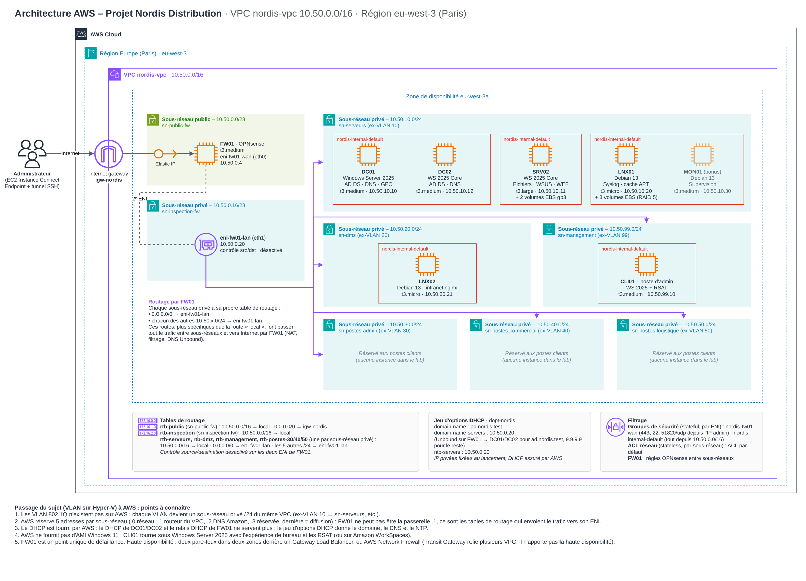
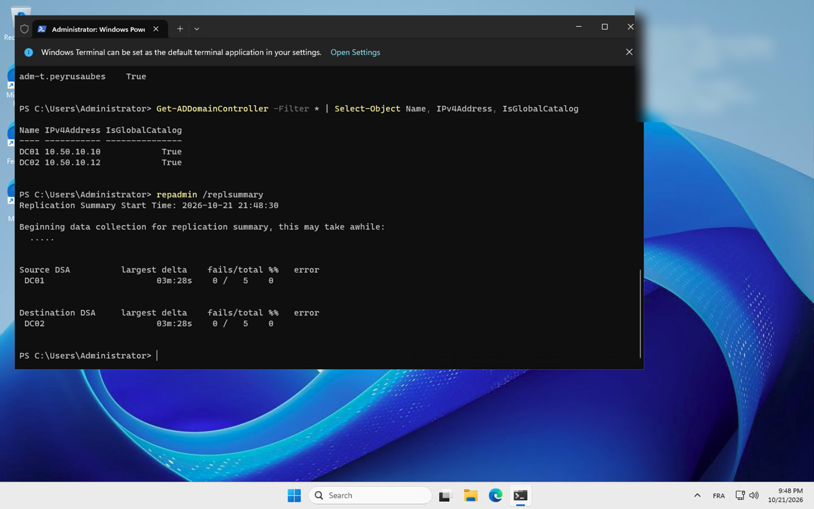
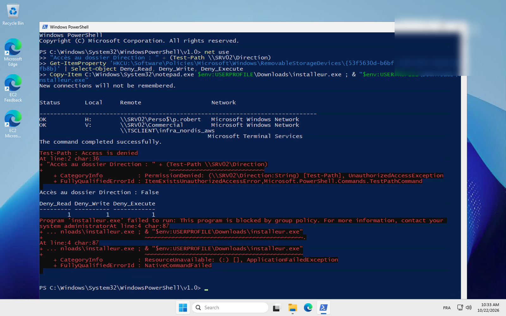
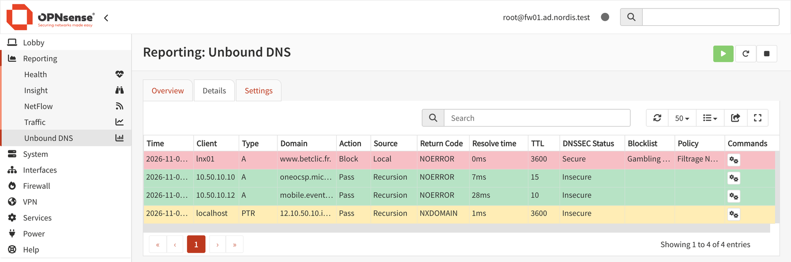
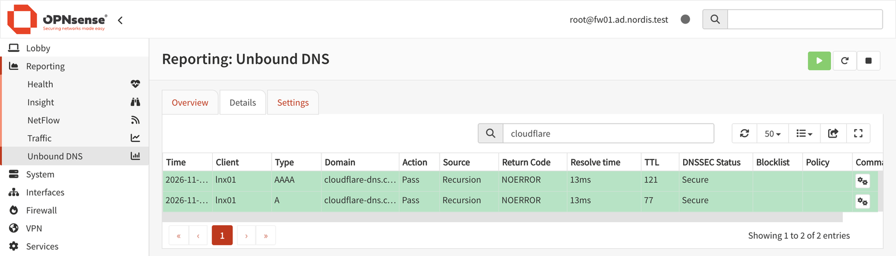

# Nordis Distribution – Infrastructure Windows / Linux sur AWS


> 🇬🇧 **English summary** – the full documentation below is in French.
>
> **What it is.** The complete IT system of a fictional 80-employee company (Nordis Distribution), **built** and then **secured** on AWS as two practical projects of my Bachelor's year 3 in Infrastructure & Cybersecurity (October – November 2026).
>
> **Project 1 – Hybrid Windows / Linux infrastructure as code**
> - **7 EC2 instances** (Windows Server 2025, Debian 13, OPNsense) in a segmented VPC (`10.50.0.0/16`: servers, DMZ, user and management subnets), created with **Terraform**.
> - **All traffic goes through the firewall**: every private subnet routes to an OPNsense firewall that handles NAT, DNS, NTP and inter-subnet filtering.
> - **No administration port exposed to the Internet**: access only through an EC2 Instance Connect Endpoint and an SSH tunnel.
> - **Every server configured by script**: 18 re-runnable PowerShell and Bash scripts, each with logging and exit codes.
> - **Services**: redundant Active Directory (2 domain controllers, DNS, DHCP failover), GPOs, AGDLP access model, file server with quotas, WSUS, centralised logs (Windows Event Forwarding, rsyslog), RAID 5 + LVM on Linux, Linux joined to the domain, tested backup and restore.
>
> **Project 2 – Controlled and secure DNS**
> - The firewall becomes the **only DNS resolver** of the company: **DNS over TLS** to Quad9 and **DNSSEC** validation on the Internet side, readable and logged on the internal side.
> - **Filtering and traceability**: blocklists (gambling, social networks), every query logged with the requesting host.
> - **Bypass attempts demonstrated, detected and blocked**: direct DNS, direct DNS over TLS, and DNS over HTTPS (by name and by IP), plus a locked browser policy.
>
> **Stack**: AWS · Terraform · OPNsense · Windows Server 2025 · Active Directory · PowerShell · Debian · Bash · Unbound · nginx
>
> **Author**: Thomas Peyrusaubes – [github.com/thomaspeyr31](https://github.com/thomaspeyr31)

Système d'information d'une PME de 80 salariés, **construit** puis **sécurisé** sur AWS en deux travaux pratiques du Bachelor 3 Infrastructure & Cybersécurité (module A2627_5066 – Administration systèmes Linux/Windows).

> **[Documentation technique complète des TP 1 et 2](DOCUMENTATION.md)** : le dossier d'exploitation demandé par le cahier des charges, chaque exigence reliée à sa réalisation et à sa preuve, avec 36 captures.



## Les deux TP

| | [TP 1 – Infrastructure hybride](tp1-infrastructure/README.md) | [TP 2 – DNS maîtrisé](tp2-dns-securise/README.md) |
| --- | --- | --- |
| **Objectif** | Déployer tout le SI par le code : réseau, annuaire, fichiers, mises à jour, journaux, sauvegarde | Faire de FW01 le seul résolveur DNS : chiffré vers Internet, visible en interne, impossible à contourner |
| **Réalisé** | 7 instances EC2 par Terraform, AD redondé, GPO, WSUS, WEF, rsyslog, RAID, sauvegarde testée, pare-feu OPNsense | DNS over TLS vers Quad9, DNSSEC, blocklists journalisées, blocage du DNS direct, du DoT et du DoH, scénario d'attaque DoH |
| **Livrables** | Terraform, scripts PowerShell et Bash, document d'architecture, dossier d'exploitation | Compte rendu avec 20 captures, script de règles anti-contournement, stratégie navigateur |
| **Période** | octobre 2026 | novembre 2026 |

### TP 1 – Infrastructure hybride Windows / Linux

- **Tout est code** : VPC, routes, groupes de sécurité et instances par Terraform ; chaque serveur configuré par un script relançable, avec journal et code de retour.
- **Tout passe par le pare-feu** : chaque sous-réseau route vers FW01 (OPNsense), qui assure NAT, DNS, NTP et filtrage ; aucun port d'administration exposé sur Internet.
- **Chaque compétence prouvée sur les deux OS** : services, droits, journaux, mises à jour, stockage redondé.

| | |
| --- | --- |
|  |  |

→ [Compte rendu du TP 1](tp1-infrastructure/README.md) · [Architecture](tp1-infrastructure/docs/architecture.md) · [Exploitation](tp1-infrastructure/docs/exploitation.md)

### TP 2 – DNS maîtrisé : chiffrement, filtrage, détection du contournement

- **Chiffré vers Internet, en clair en interne** : le WAN ne transporte que du TLS vers Quad9, tandis que le LAN reste lisible pour filtrer et journaliser.
- **Filtrant et traçable** : jeux d'argent et réseaux sociaux bloqués, chaque requête journalisée avec le poste à l'origine.
- **Contournement démontré, détecté puis refermé** : DNS direct, DoT direct, DoH par nom et par IP.

| | |
| --- | --- |
|  |  |

→ [Compte rendu du TP 2](tp2-dns-securise/README.md)

## Organisation du dépôt

```
.
├── DOCUMENTATION.md       Documentation technique complète des deux TP
├── tp1-infrastructure/    TP 1 – Infrastructure hybride
│   ├── terraform/           VPC, routes, groupes de sécurité, instances, disques
│   ├── firewall/            OPNsense : installation, filtrage entre sous-réseaux
│   ├── scripts/             windows/ (PowerShell), linux/ (Bash)
│   └── docs/                architecture, exploitation, captures, rapports GPO et WSUS
├── tp2-dns-securise/      TP 2 – DNS maîtrisé
│   ├── firewall/            règles anti-contournement DNS / DoT / DoH
│   ├── navigateur/          stratégie Firefox (DoH désactivé)
│   └── captures/            preuves du compte rendu
└── outils/                Commun aux deux TP
    └── nordis-tunnel.sh     accès d'administration avec reconnexion automatique
```

## Accès d'administration

Aucun port d'administration n'est ouvert sur Internet : l'accès passe par un EC2 Instance Connect Endpoint, puis par le SSH de FW01.

```bash
outils/nordis-tunnel.sh      # tunnel + redirections, se reconnecte seul ; Ctrl+C pour arrêter
```

| Machine | Accès |
| --- | --- |
| FW01 | https://localhost:8443 · `ssh -i ~/.ssh/nordis.pem -p 2222 root@127.0.0.1` |
| DC01 · DC02 · SRV02 · CLI01 | RDP `127.0.0.1:13389` · `33389` · `43389` · `23389` |
| LNX01 · LNX02 | `ssh -i ~/.ssh/nordis.pem -p 2201 admin@127.0.0.1` · `-p 2202` |

Démarrage, arrêt et procédures de reprise : [dossier d'exploitation](tp1-infrastructure/docs/exploitation.md).

## Confidentialité

- Aucun secret dans le dépôt : état Terraform, variables locales et clés sont exclus par `.gitignore`, les mots de passe sont saisis à l'exécution des scripts.
- Les captures sont recadrées : ni onglets de navigateur, ni adresse IP publique, ni identifiant de compte AWS.

---

**Auteur** : Thomas Peyrusaubes · Bachelor 3 Infrastructure & Cybersécurité · octobre – novembre 2026
