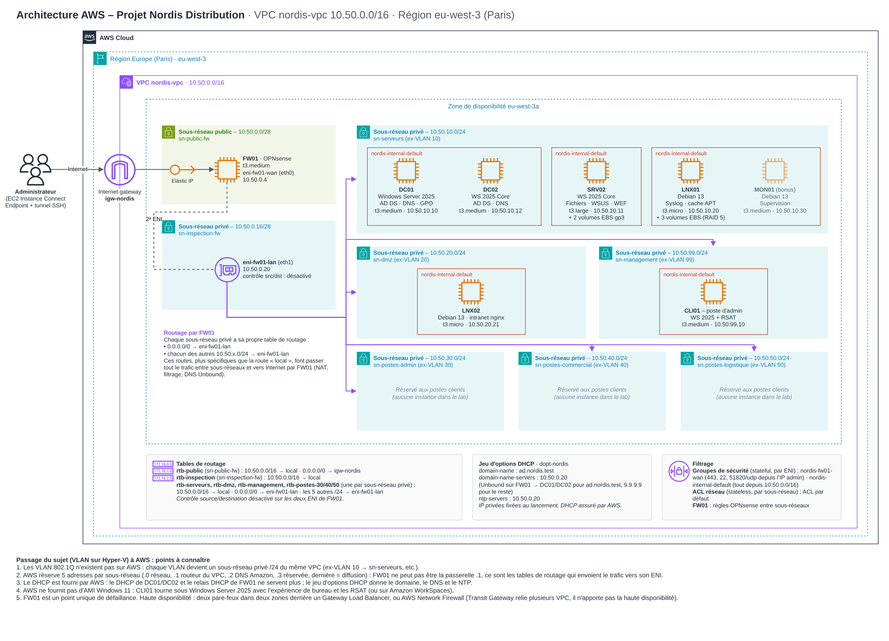

# Document d'architecture technique

L'infrastructure Nordis tourne sur AWS (région Paris, zone `eu-west-3a`) : 7 instances EC2 dans un VPC `10.50.0.0/16`, derrière le pare-feu OPNsense FW01, seul point d'entrée et de sortie.

## Choix techniques

| Serveur | Système | Mode | Justification |
| --- | --- | --- | --- |
| FW01 | OPNsense 26.7 (base FreeBSD 15.1) | Interface web | Pare-feu open source maintenu. Pas d'image officielle sur AWS : conversion d'une image FreeBSD avec l'outil officiel `opnsense-bootstrap`. |
| DC01 | Windows Server 2025 Datacenter | Avec bureau | Contrôleur principal, consoles locales. Support jusqu'en 2034. |
| DC02, SRV02 | Windows Server 2025 | **Server Core** | Surface d'attaque et empreinte réduites ; administrés à distance depuis CLI01. |
| LNX01, LNX02 | Debian 13 « Trixie » | Sans interface | Version stable actuelle, administration SSH par clé. |
| CLI01 | Windows Server 2025 | Avec bureau | Poste d'administration RSAT (Windows 11 indisponible sur EC2 sans hôte dédié). |

## Machines

| Machine | Type EC2 | IP | Disques |
| --- | --- | --- | --- |
| FW01 | t3.medium | WAN 10.50.0.4 + IP publique · LAN 10.50.0.20 | 20 Go |
| DC01 | t3.medium | 10.50.10.10 | 40 Go |
| DC02 | t3.medium | 10.50.10.12 | 30 Go |
| SRV02 | t3.large | 10.50.10.11 | 30 Go + 2 × 30 Go (miroir) |
| LNX01 | t3.micro | 10.50.10.20 | 10 Go + 3 × 10 Go (RAID 5) |
| LNX02 | t3.micro | 10.50.20.21 | 10 Go |
| CLI01 | t3.medium | 10.50.99.10 | 40 Go |

IP fixées par Terraform sur l'interface de chaque instance ; volumes EBS gp3 chiffrés ; IMDSv2 obligatoire. Coût tout allumé : environ 0,45 $/h.

## Routage et filtrage

Trois couches se superposent.

1. **Tables de routes AWS.** Chaque sous-réseau privé a sa table : `0.0.0.0/0` et les 5 autres `/24` vont vers l'interface LAN de FW01 (routes plus précises que la route locale du VPC). Contrôle source/destination désactivé sur les deux interfaces de FW01.
2. **Groupes de sécurité.** `nordis-fw01-wan` : 443, 22, 51820/udp depuis l'IP de l'administrateur seulement. `nordis-internal-default` : tout depuis `10.50.0.0/16`.
3. **Règles OPNsense** (interface LAN, `firewall/fw01_filtrage.sh`) :

| Ordre | Source | Destination | Ports |
| --- | --- | --- | --- |
| 10 | Management 10.50.99.0/24 | tout | tous |
| 11 | Serveurs 10.50.10.0/24 | tout | tous |
| 20–21 | Postes (30, 40, 50) | FW01 | DNS 53, NTP 123 |
| 22 | Postes | DC01, DC02 | ports AD (53, 88, 123, 135, 389, 445, 464, 636, 3268-3269, 9389, 49152-65535) |
| 23 | Postes | SRV02 | 445, 8530 |
| 24 | Postes | LNX02 | 80 |
| 25 | Postes | Internet (hors RFC 1918) | 80, 443 |
| 30–31 | DMZ 10.50.20.0/24 | LNX01 | 3142, 514 |
| 32–33 | DMZ | FW01 | DNS 53, NTP 123 |
| 34 | DMZ | Internet (hors RFC 1918) | 80, 443 |
| 90 | tout le reste | – | bloqué et journalisé |

Sortie Internet : NAT de FW01 (source `10.50.0.0/16` → adresse WAN).

**Administration** : EC2 Instance Connect Endpoint dans le sous-réseau Management → SSH de FW01 → redirections de ports vers le RDP des serveurs et le SSH des Linux. Aucun port d'administration n'est exposé sur Internet.

## DNS, DHCP, temps

- **DNS** : tous les hôtes interrogent FW01 (Unbound), donné par le jeu d'options DHCP du VPC. `ad.nordis.test` et `50.10.in-addr.arpa` → DC01/DC02 ; le reste → Quad9 (9.9.9.9, 149.112.112.112). Zone AD intégrée à l'annuaire, répliquée sur DC02.
- **DHCP** : adresses distribuées par le VPC. Rôle DHCP Windows configuré pour la démonstration : étendues 10.50.30/40/50.100-200, bail 8 jours, basculement DC01-DC02 en 50/50.
- **Temps** : pools NTP → FW01 → DC01 (secours Amazon Time Sync) → DC02 et membres ; LNX01 sur les DC (chrony), LNX02 sur FW01.
- **Ordre de démarrage** : FW01 → DC01, DC02 → LNX01 → SRV02, CLI01, LNX02. Arrêt dans l'ordre inverse.

## Services

| Domaine | Windows | Linux |
| --- | --- | --- |
| Annuaire | `OU=Nordis` : une OU par service, `Ordinateurs/Postes`, `Ordinateurs/Serveurs`, `Groupes`, `Comptes_Admin` ; corbeille AD | LNX01 joint (realmd/sssd), connexion réservée à `GG-Admins-Linux` et `Grp_IT`, homes dans `/home/AD` ; LNX02 hors domaine (DMZ) |
| Droits | AGDLP : `Grp_<Service>` → `DL-<Partage>-RW/RO` ; compte d'administration distinct | sudo : `GG-Admins-Linux` (LNX01), `sudo` local (LNX02) ; SSH par clé, `AllowGroups` |
| Stockage | Storage Spaces miroir → E: (27 Go) ; quotas FSRM 5 Go / partage, 1 Go auto / perso | RAID 5 mdadm (20 Go) + LVM : journaux 4 Go, home AD 4 Go, cache APT 12 Go, par UUID |
| GPO | Mots de passe 12 car., complexité, 90 j, historique 24, verrouillage 5 échecs ; Commercial : USB interdit, AppLocker ; WSUS ; WEF | – |
| Mises à jour | WSUS : Windows Server 2025, critiques + sécurité, FR + EN, approbation auto, 19 h, métadonnées seules | `trixie-security` + unattended-upgrades ; apt-cacher-ng (3142) |
| Sauvegarde | Quotidienne 19 h (SYSTEM) : Perso + Partages avec ACL → `E:\Sauvegardes\<date>`, 7 conservées | – |
| Journaux | Audit sur les DC ; WEF DC01, DC02, SRV02 → SRV02 | rsyslog central LNX01 (514 UDP/TCP), un dossier par hôte |

## Écarts avec le DAT d'origine (Hyper-V)

| DAT d'origine | Sur AWS | Justification |
| --- | --- | --- |
| VLAN 802.1Q tagués sur FW01 | Sous-réseaux /24 routés vers FW01 | Pas de VLAN dans un VPC ; même découpage, même filtrage |
| FW01 = .1 de chaque VLAN | FW01 = 10.50.0.20 | AWS réserve le .1 de chaque sous-réseau |
| DHCP via relais FW01 | DHCP du VPC ; DHCP Windows configuré mais inutilisé | AWS n'accepte pas d'autre serveur DHCP |
| CLI01 sous Windows 11 | Windows Server 2025 avec bureau | Pas de Windows 11 sur EC2 sans hôte dédié |
| RAM 512 Mo – 4 Go | t3.micro – t3.large | Tailles autorisées par les droits IAM |
| Windows Admin Center | Non installé | Administration PowerShell / RSAT depuis CLI01 |
| Profil réseau Domaine sur CLI01 | Reste « Public » | Comportement connu sur EC2 ; règle WinRM Public limitée à `10.50.0.0/16` |

Limite : FW01 est un point unique de défaillance. En production : deux pare-feux dans deux zones derrière un Gateway Load Balancer, ou AWS Network Firewall.
