# DNS sécurisé : chiffrement, filtrage et détection du contournement

Compte rendu du TP DNS sur l'infrastructure Nordis (novembre 2026).

**Objectif** : faire de FW01 (Unbound) le **seul résolveur DNS** de l'entreprise, et un résolveur :

- **chiffré** vers Internet (DNS over TLS vers Quad9) ;
- **validé** (DNSSEC) ;
- **filtrant** (jeux d'argent, réseaux sociaux) ;
- **journalisé** (qui a demandé quoi, quand) ;
- **impossible à contourner** (DNS direct, DoT direct et DoH bloqués ou détectés).

## Sommaire

1. [Architecture cible](#1-architecture-cible)
2. [Configuration d'Unbound](#2-configuration-dunbound)
3. [Interdire le contournement](#3-interdire-le-contournement)
4. [Preuves : clair sur le LAN, chiffré sur le WAN](#4-preuves--clair-sur-le-lan-chiffré-sur-le-wan)
5. [Filtrage par blocklist](#5-filtrage-par-blocklist)
6. [Scénario DoH : contourner, détecter, refermer](#6-scénario-doh--contourner-détecter-refermer)
7. [Réponses aux questions du TP](#7-réponses-aux-questions-du-tp)
8. [Points délicats rencontrés](#8-points-délicats-rencontrés)
9. [Limites et améliorations](#9-limites-et-améliorations)

---

## 1. Architecture cible

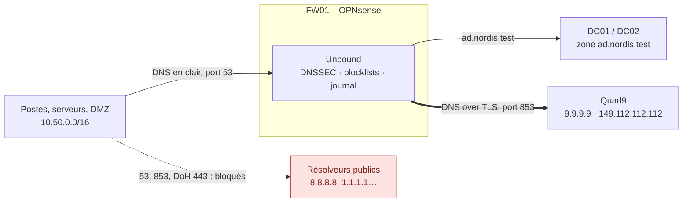

| Segment | Ce qui circule | Pourquoi |
| --- | --- | --- |
| Poste → FW01 (LAN) | DNS **en clair**, port 53 | Volontaire : c'est ce qui permet de **filtrer** et de **journaliser** |
| FW01 → Quad9 (WAN) | DNS **chiffré** (TLS), port 853 | Le FAI et le réseau ne voient ni les noms demandés, ni les postes |
| FW01 → DC01/DC02 | DNS, port 53 | La zone Active Directory reste servie par les contrôleurs de domaine |
| Poste → Internet en direct | **bloqué** (53, 853, DoH par IP) | Aucun poste ne peut éviter le résolveur de l'entreprise |

**Adaptations par rapport au sujet du TP** (écrit pour la maquette Hyper-V) :

| Sujet du TP | Infrastructure AWS | Raison |
| --- | --- | --- |
| Résolveur `10.50.20.1` / `10.50.10.1` | `10.50.0.20` (LAN de FW01) | Pas de VLAN dans un VPC, AWS réserve le `.1` |
| DC02 = `10.50.10.11` | DC02 = `10.50.10.12` (`.11` = SRV02) | Plan d'adressage du DAT |
| Interfaces Serveurs, Postes, DMZ, Management | Interface **LAN** seule | Tous les sous-réseaux arrivent sur le LAN de FW01 |
| `tcpdump -i em0` | WAN = **`ena0`**, LAN = **`ena1`** | Cartes réseau AWS (pilote ENA) |
| Firefox sur CLI01 | `curl` sur LNX01 | Même mécanisme DoH, testable sans interface graphique (§ 6) |

---

## 2. Configuration d'Unbound

Prérequis : **FW01 doit être à l'heure** (Services > Network Time). DNSSEC vérifie des signatures datées : avec une horloge fausse, tout est rejeté.

| Menu | Réglage | Valeur |
| --- | --- | --- |
| System > Settings > General | DNS servers | vide |
| | Allow DNS server list to be overridden by DHCP/PPP on WAN | décoché |
| Services > Unbound DNS > General | Enable · Listen Port | coché · 53 |
| | Network Interfaces | **LAN** uniquement |
| | Enable DNSSEC Support | coché |
| Unbound DNS > Query Forwarding | Use System Nameservers | décoché |
| | `ad.nordis.test` et `50.10.in-addr.arpa` | → `10.50.10.10` et `10.50.10.12` |
| Unbound DNS > DNS over TLS | `9.9.9.9` et `149.112.112.112` | port **853**, Verify CN `dns.quad9.net` |
| Unbound DNS > Advanced | Private Domains · Insecure Domains | `ad.nordis.test` |
| | Extended Statistics · Log Queries | cochés |
| | Log Level Verbosity | Level 2 |
| Reporting > Unbound DNS > Settings | Enabled | coché (journal des requêtes) |

> [!WARNING]
> **Network Interfaces sur « All »** inclut le WAN : Unbound répondrait à Internet (résolveur ouvert, utilisable pour des attaques par amplification). Il faut sélectionner **LAN** seulement.

> [!WARNING]
> **Quad9 en clair dans Query Forwarding.** La configuration d'origine envoyait aussi les requêtes à Quad9 sur le **port 53, en clair**. Ces deux lignes ont été supprimées et remplacées par les entrées DNS over TLS.
>
> 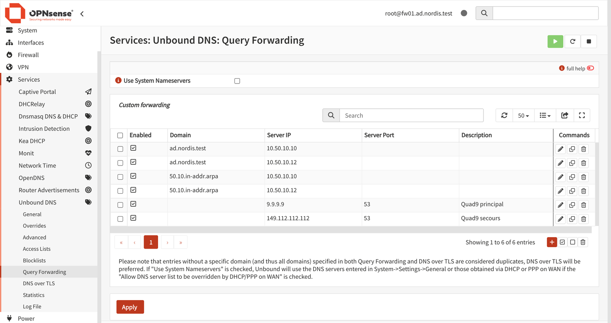

Configuration DNS over TLS finale (le premier serveur est le principal, le second le secours) :

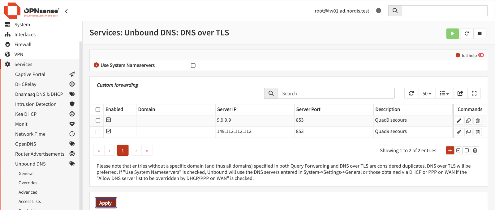

> [!IMPORTANT]
> **DNSSEC et la zone `ad.nordis.test`.** Le domaine `.test` n'est pas signé. Avec DNSSEC activé, Unbound rejetterait les réponses des contrôleurs de domaine (SERVFAIL) : plus aucune ouverture de session ne fonctionnerait. `ad.nordis.test` est donc déclaré en **Insecure Domains** (pas de validation) et en **Private Domains** (réponses en adresses privées acceptées).
>
> 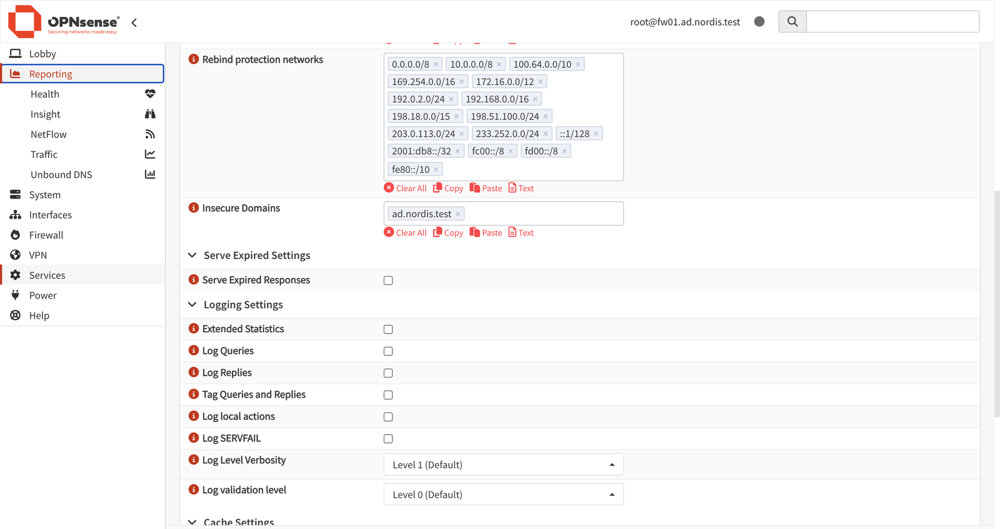

**Vérification depuis LNX01** (ainsi que les tests de la partie 3) :

```bash
dig @10.50.0.20 +short txt proto.on.quad9.net   # "dot"  → Quad9 reçoit bien du DNS over TLS
dig @10.50.0.20 +dnssec isc.org | grep flags     # flag ad → réponse validée par DNSSEC
dig @10.50.0.20 +short dc01.ad.nordis.test       # 10.50.10.10 → zone AD transmise aux DC
```

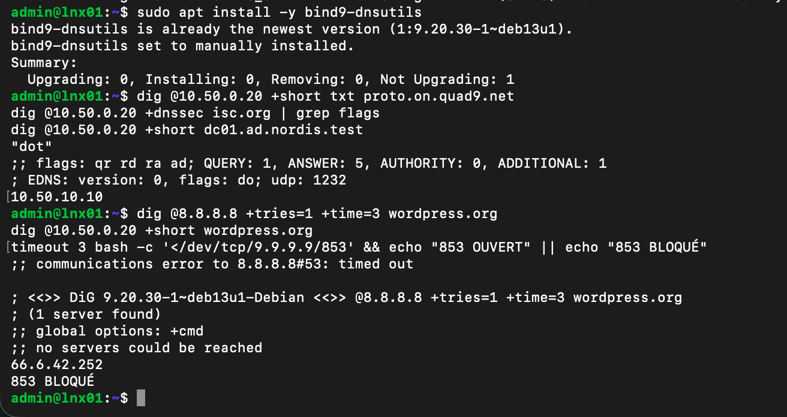

---

## 3. Interdire le contournement

Le résolveur ne sert à rien si un poste peut interroger `8.8.8.8` directement. Quatre règles sont ajoutées sur l'interface LAN, **avant** les règles 10 (Management) et 11 (Serveurs) qui autorisent « tout vers tout » : OPNsense applique la **première règle qui correspond**.

| Ordre | Action | Source | Destination | Port | Journal | Rôle |
| --- | --- | --- | --- | --- | --- | --- |
| 1 | Pass | `10.50.0.0/16` | This Firewall | 53 TCP/UDP | – | DNS vers Unbound |
| 2 | Block | `10.50.0.0/16` | **hors** `10.50.0.0/16` | 53 TCP/UDP | ✓ | DNS direct interdit |
| 3 | Block | `10.50.0.0/16` | **hors** `10.50.0.0/16` | 853 TCP/UDP | ✓ | DoT direct interdit |
| 4 | Block | `10.50.0.0/16` | alias `DoH_publics` | 443 TCP/UDP | ✓ | DoH par IP interdit (§ 6.3) |

« Hors `10.50.0.0/16` » correspond à la case **Invert Destination** : la règle vise toute destination extérieure, sans gêner le DNS interne (DC, FW01). Ces règles sont aussi dans [`firewall/fw01_filtrage.sh`](../firewall/fw01_filtrage.sh).

Création de la règle 1 (Firewall > Rules > LAN > **+**), section Filter :

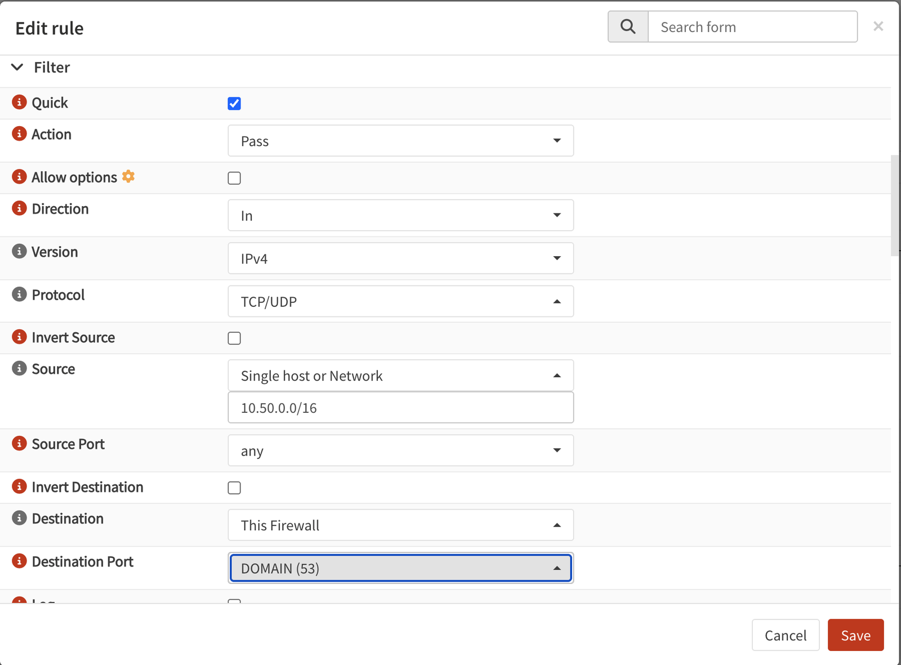

Résultat : les règles DNS passent avant « Management vers tout » et « Serveurs vers tout ». La croix rouge signale un blocage, la cloche une règle journalisée.

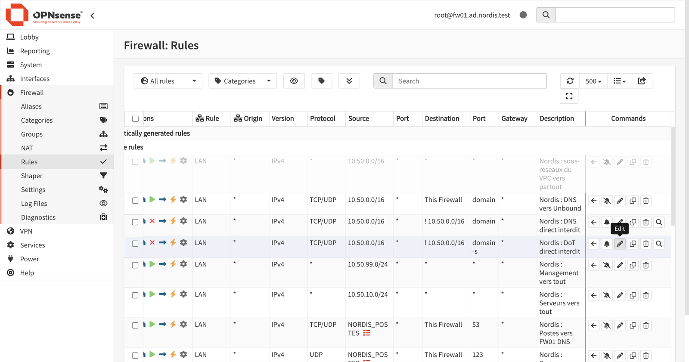

> [!WARNING]
> **Copier une règle, pas la modifier.** Pour créer une règle proche d'une autre, il faut cliquer sur l'icône **copier** (deux carrés), **pas sur le crayon** juste à côté. Pendant le TP, la règle DoT a été modifiée par erreur au lieu d'être copiée : le port 853 s'est retrouvé ouvert sans aucune alerte. Seul le test de non-régression l'a révélé (voir § 6.3). **Après chaque modification du pare-feu, on relance tous les tests**, pas seulement celui de la règle ajoutée.

**Tests** (capture de la partie 2) :

| Test | Commande (LNX01) | Attendu | Obtenu |
| --- | --- | --- | --- |
| DNS direct | `dig @8.8.8.8 +tries=1 +time=3 wordpress.org` | timed out | ✅ `timed out` |
| DNS via FW01 | `dig @10.50.0.20 +short wordpress.org` | une adresse | ✅ `66.6.42.252` |
| DoT direct | `timeout 3 bash -c '</dev/tcp/9.9.9.9/853'` | refusé | ✅ `853 BLOQUÉ` |

---

## 4. Preuves : clair sur le LAN, chiffré sur le WAN

Captures `tcpdump` sur la console de FW01 (menu, option 8). FW01 génère lui-même une requête avec `drill`, ce qui évite de jongler entre deux terminaux.

**WAN (`ena0`) : uniquement du port 853 vers Quad9**

```text
root@fw01:~ # timeout 8 tcpdump -l -ni ena0 'port 53 or port 853' & sleep 2; drill wikipedia.org @127.0.0.1 > /dev/null; wait
09:50:17.735362 IP 10.50.0.4.16899 > 9.9.9.9.853: Flags [S], ...                  length 0     ← ouverture TCP
09:50:17.736806 IP 10.50.0.4.16899 > 9.9.9.9.853: Flags [.], seq 1:1449, ...      length 1448  ← négociation TLS
09:50:17.740674 IP 10.50.0.4.16899 > 9.9.9.9.853: Flags [P.], seq 1627:1779, ...  length 152   ← question chiffrée
09:50:17.744837 IP 9.9.9.9.853 > 10.50.0.4.16899: Flags [P.], seq 4090:4891, ...  length 801   ← réponse chiffrée
24 packets captured
```

Aucune ligne en `.53`, aucun nom de domaine lisible, et seule l'adresse WAN de FW01 apparaît, jamais celle d'un poste.

**LAN (`ena1`), DNSSEC et absence de repli en clair**

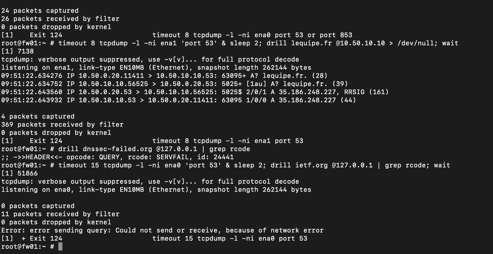

| # | Test | Résultat | Lecture |
| --- | --- | --- | --- |
| 1 | `tcpdump -ni ena1 'port 53'` + `drill lequipe.fr @10.50.10.10` | `A? lequipe.fr.` visible | Sur le LAN, les noms sont lisibles : c'est ce qui rend le filtrage possible. On voit toute la chaîne : FW01 → DC01 → Unbound (redirecteur des DC) → réponse avec signature `RRSIG` |
| 2 | `drill dnssec-failed.org @127.0.0.1` | `SERVFAIL` | Domaine de test volontairement mal signé : DNSSEC refuse la réponse |
| 3 | DoT passé sur le port 854, puis `tcpdump -ni ena0 'port 53'` | `0 packets captured` | Quand le DoT est cassé, Unbound **échoue** au lieu de repasser en clair |

> [!CAUTION]
> **Remettre le port 853 après le test 3.** Tant que le port reste à 854, plus rien ne se résout sur Internet. Le changement ne compte qu'après **Save puis Apply**. Pour vérifier ce qu'Unbound utilise réellement, sans se fier à l'interface :
>
> ```sh
> grep -rh --exclude-dir=dev forward-addr /var/unbound   # doit afficher 9.9.9.9@853#dns.quad9.net
> drill wordpress.com @127.0.0.1 | grep rcode            # doit afficher NOERROR
> ```
>
> 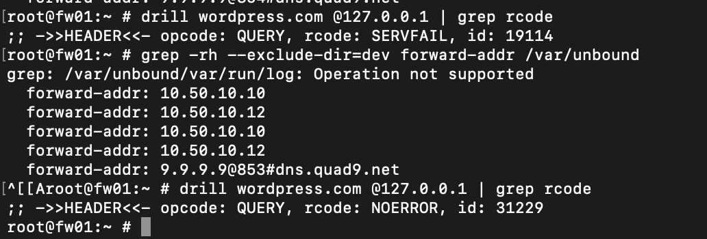

---

## 5. Filtrage par blocklist

**Services > Unbound DNS > Blocklists > +** : catégories Gambling et Social Networks (listes Hagezi), Source Net(s) vide (tous les réseaux), description « Filtrage Nordis ».

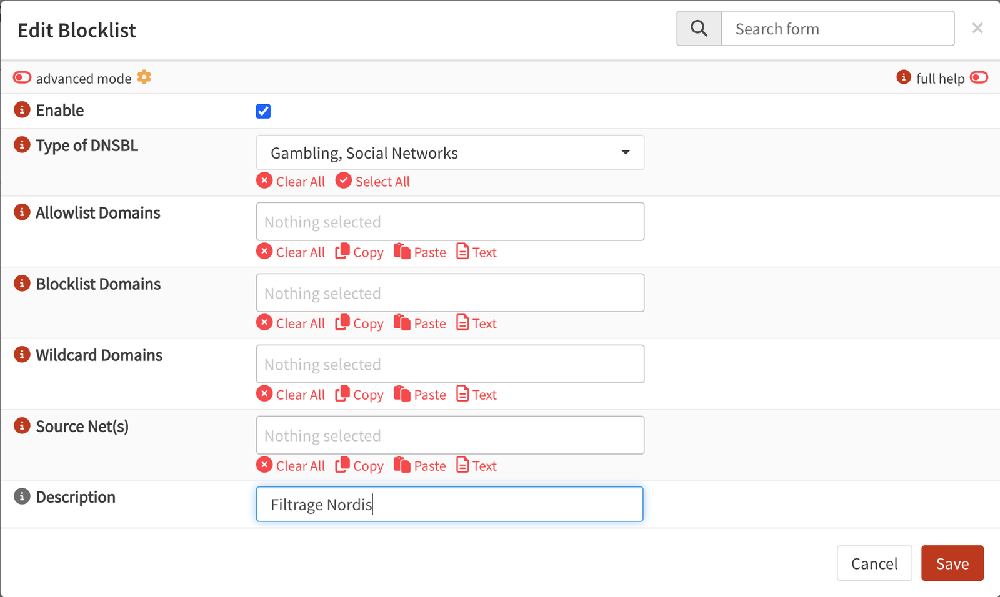

> [!NOTE]
> **Pas de liste malware / phishing.** Le sujet du TP prévoit aussi une liste de sécurité, mais OPNsense ne la propose pas parmi les types de DNSBL de cette version : seules les catégories Gambling et Social Networks correspondaient au besoin. Le blocage des domaines malveillants est assuré **en amont par Quad9** : le service `9.9.9.9` refuse de résoudre les domaines malveillants connus, à partir de flux de renseignement sur les menaces. Pour une couche locale en plus, un flux public peut être ajouté en *URLs of Blocklists* (voir § 9).

L'onglet **Tester** montre la décision d'Unbound, la liste et la catégorie qui l'ont déclenchée :

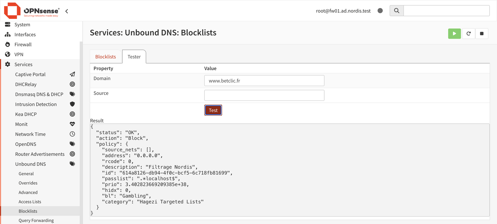

Depuis un vrai client (LNX01) : le site bloqué reçoit l'adresse `0.0.0.0`, Wikipédia reçoit sa vraie adresse.

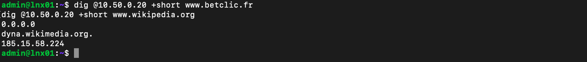

> [!WARNING]
> **Le journal des requêtes est désactivé par défaut.** Reporting > Unbound DNS affiche « Local gathering of statistics is not enabled ». Il faut cocher **Enabled** dans l'onglet Settings. Les requêtes antérieures ne sont pas rattrapées : il faut refaire les tests après l'activation.
>
> 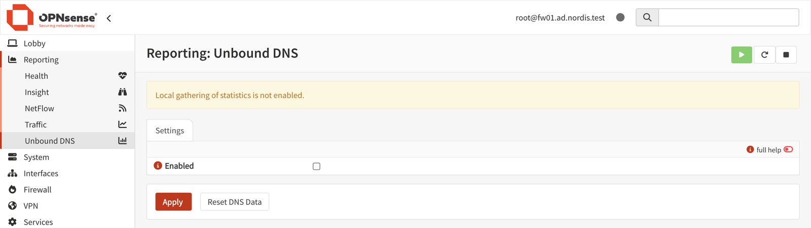

Journal après activation : le poste (`lnx01`), le nom, l'action **Block**, la liste et la politique responsables.

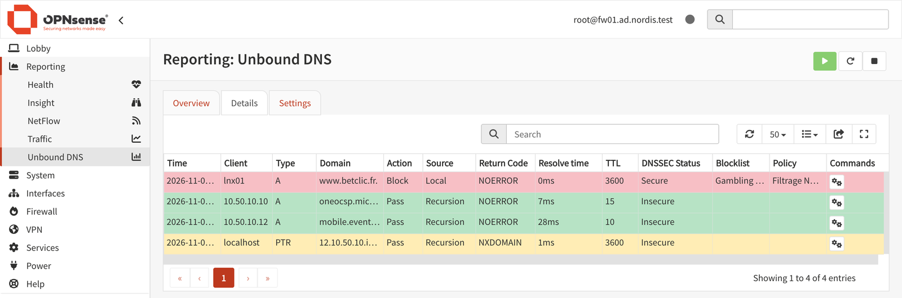

---

## 6. Scénario DoH : contourner, détecter, refermer

Avec le DoH (DNS over HTTPS), une application envoie ses questions DNS **chiffrées dans du HTTPS** directement à un résolveur public, sans passer par Unbound. Pour le pare-feu, c'est du trafic web ordinaire sur le port 443.

> [!NOTE]
> Le TP prévoit Firefox sur CLI01. Le test a été fait avec `curl` sur LNX01, depuis le terminal d'administration : c'est exactement la requête qu'envoie un navigateur en mode DoH (`GET https://cloudflare-dns.com/dns-query?...`).

### 6.1 Contourner

```bash
dig @10.50.0.20 +short www.facebook.com     # 0.0.0.0 : bloqué par Unbound
curl -s -H 'accept: application/dns-json' \
  'https://cloudflare-dns.com/dns-query?name=www.facebook.com&type=A'   # vraie adresse : contournement réussi
```

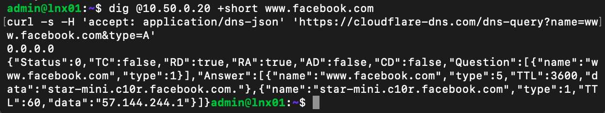

### 6.2 Détecter

Le DoH est chiffré, mais avant d'envoyer sa requête, le client doit trouver l'adresse du serveur DoH. **Cette résolution part en clair vers Unbound** et apparaît dans le journal.

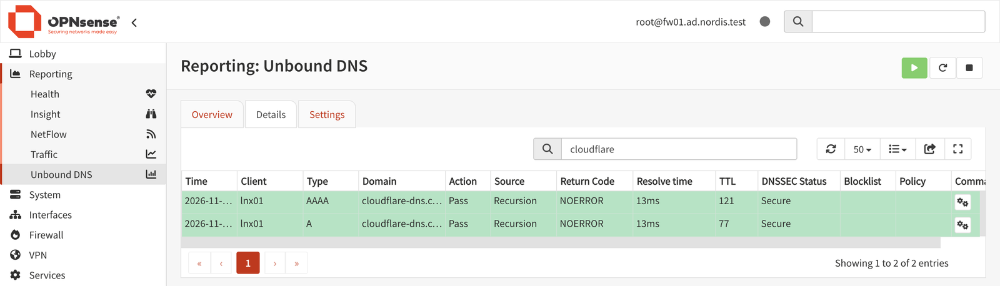

| Nom observé dans le journal | Ce que ça révèle |
| --- | --- |
| `cloudflare-dns.com`, `mozilla.cloudflare-dns.com` | DoH Cloudflare (Firefox par défaut) |
| `dns.google`, `doh.opendns.com`, `dns.nextdns.io` | Autres fournisseurs DoH |
| `use-application-dns.net` | Sonde de Firefox avant d'activer seul le DoH |

### 6.3 Refermer : trois couches

**Couche 1 : bloquer les noms DoH.** Une seconde blocklist, en **Wildcard Domains** (le nom et tous ses sous-domaines) : `cloudflare-dns.com`, `dns.google`, `doh.opendns.com`, `dns.nextdns.io`.

> [!CAUTION]
> Ne **pas** ajouter `dns.quad9.net` : c'est le résolveur de FW01.

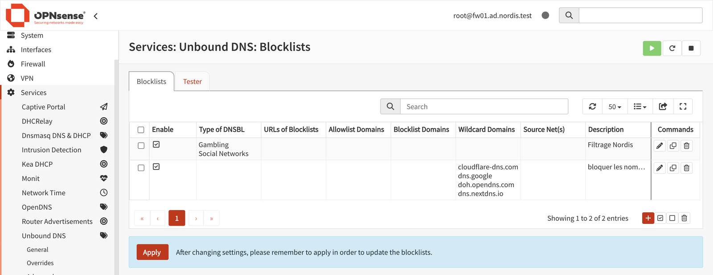

`cloudflare-dns.com` répond désormais `0.0.0.0` et le DoH par nom échoue. **Mais** un client qui contacte directement l'adresse IP du résolveur n'a besoin d'aucune résolution :

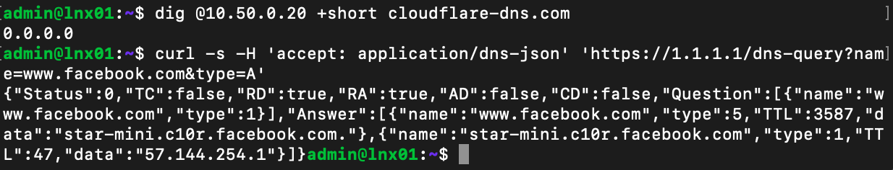

**Couche 2 : bloquer les IP DoH.** Alias `DoH_publics` (Firewall > Aliases, type Host(s)), puis la règle 4 du § 3 : blocage de `DoH_publics` en TCP **et UDP** 443 (l'UDP couvre HTTP/3 / QUIC).

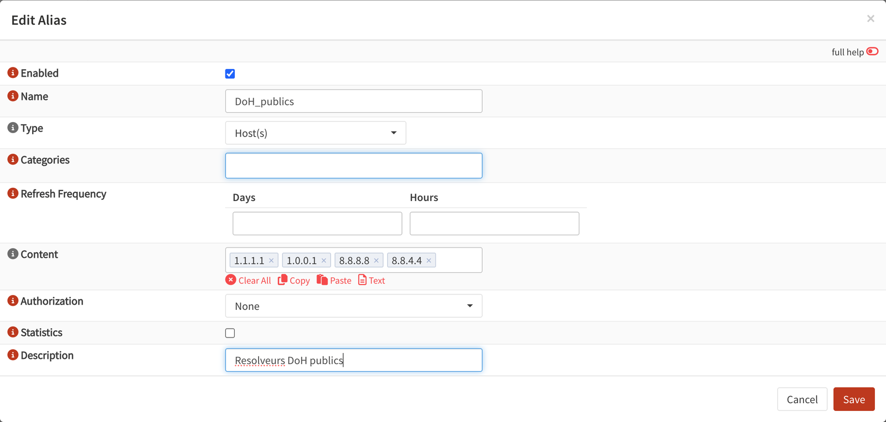

```bash
curl -s --max-time 5 -H 'accept: application/dns-json' \
  'https://1.1.1.1/dns-query?name=www.facebook.com&type=A' ; echo "code retour : $?"
```

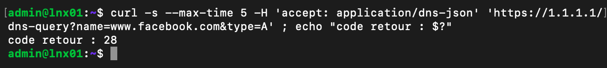

`28` = délai dépassé : le pare-feu jette la connexion.

**Couche 3 : verrouiller le navigateur.** On désactive le DoH dans le navigateur, et l'utilisateur ne peut plus le réactiver.

| Système | Méthode | Réglage |
| --- | --- | --- |
| Linux (Firefox) | `/etc/firefox/policies/policies.json` | `{ "policies": { "DNSOverHTTPS": { "Enabled": false, "Locked": true } } }` |
| Windows (Edge, Chrome) | GPO, modèles d'administration | `DnsOverHttpsMode` = `off` |
| Windows (Firefox) | GPO, modèles Firefox | DNS over HTTPS : désactivé et verrouillé |

En entreprise, ce réglage se déploie par GPO ou par l'outil de gestion de parc, pas poste par poste.

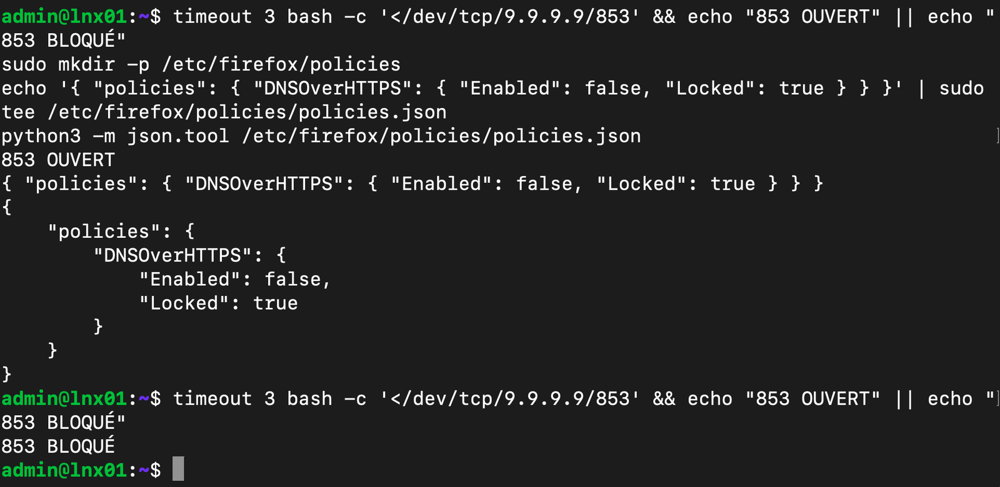

Sur cette capture, le premier test affiche **`853 OUVERT`** : c'est l'erreur décrite au § 3 (règle DoT modifiée au lieu d'être copiée). Après recréation de la règle 3, le dernier test affiche `853 BLOQUÉ`.

---

## 7. Réponses aux questions du TP

**Question 1 – Sur la capture WAN, pourquoi ne voit-on jamais l'adresse de la machine qui a posé la question ?**
Unbound est un intermédiaire. Il reçoit la question du poste sur le LAN, puis **pose lui-même une nouvelle question** à Quad9 depuis sa propre adresse WAN. La requête d'origine ne sort jamais du réseau interne. Quad9 et le FAI ne voient donc que FW01 (`10.50.0.4`, puis l'IP publique après NAT), jamais `10.50.x.x`. Et si la réponse est déjà en cache, rien ne sort du tout.

**Question 2 – Le pare-feu sait-il quelle page de betclic.fr l'utilisateur voulait voir ? Que voit-il exactement ?**
Non. Le DNS ne transporte que le **nom de domaine**, pas l'adresse complète de la page. Le pare-feu voit l'adresse du poste, le nom `www.betclic.fr`, le type de requête (A, AAAA), l'heure et la décision (Block), comme le montre le journal du § 5. Le chemin de la page (`/paris/football/…`) se trouve dans la requête HTTP, chiffrée par TLS. Ici, elle n'est même jamais envoyée, puisque la résolution a renvoyé `0.0.0.0`.

**Question 3 – Pourquoi la règle « DNS uniquement vers This Firewall » n'a-t-elle pas empêché le contournement ?**
Cette règle et les blocages associés portent sur les ports **53** (DNS) et **853** (DoT). Le DoH utilise le port **443**, celui du web, qui doit rester ouvert pour la navigation. Sans déchiffrement TLS, le pare-feu ne peut pas distinguer une requête DoH d'une page web ordinaire.

**Question 4 – Pourquoi bloquer un nom de domaine dans Unbound suffit à casser le DoH, alors que les requêtes DoH sont chiffrées ?**
Avant d'ouvrir la moindre connexion chiffrée, le client doit connaître l'adresse IP du serveur DoH (`cloudflare-dns.com`), et cette résolution part **en clair vers Unbound**. Si Unbound répond `0.0.0.0`, la connexion HTTPS ne peut pas s'établir, et le tunnel chiffré n'existe jamais. Le navigateur revient alors au DNS système (donc à Unbound et à ses filtres), ou bien échoue. Dans les deux cas, pas de contournement. *Limite* : un client qui contacte directement une IP (`1.1.1.1`) n'a besoin d'aucune résolution, d'où le blocage complémentaire des IP DoH (§ 6.3, couche 2).

---

## 8. Points délicats rencontrés

| Problème | Symptôme | Cause | Solution |
| --- | --- | --- | --- |
| Zone AD et DNSSEC | `SERVFAIL` sur `*.ad.nordis.test` (risque) | `.test` n'est pas signé | `ad.nordis.test` en Insecure Domains et Private Domains (§ 2) |
| Quad9 en clair | Requêtes en port 53 sur le WAN | Anciennes lignes de Query Forwarding | Les supprimer et passer par DNS over TLS (§ 2) |
| Règle modifiée au lieu d'être copiée | `853 OUVERT` sans alerte | Clic sur le crayon au lieu de l'icône copier | Recréer la règle ; relancer **tous** les tests après chaque changement (§ 3) |
| Test de non-repli | `SERVFAIL` persistant après retour à 853 | Changement non appliqué (Save sans Apply) | Vérifier `forward-addr` dans `/var/unbound`, refaire Save puis Apply (§ 4) |
| Journal vide | « Local gathering of statistics is not enabled » | Option désactivée par défaut | Reporting > Unbound DNS > Settings > Enabled (§ 5) |
| `drill` échoue au premier essai | `Could not send or receive` | Délai de `drill` plus court que celui d'Unbound quand le serveur est injoignable | Relancer la commande ; le `0 packets` du `tcpdump` suffit comme preuve |
| Commandes shell sur FW01 | `grep: 2: No such file or directory` | Le shell root d'OPNsense est `csh` : `2>/dev/null` n'existe pas | Ne pas rediriger, ou lancer `sh -c '…'` |
| `grep -r` bloqué sur FW01 | La commande ne rend plus la main | `/var/unbound` contient un `dev/` monté (chroot) | `grep -r --exclude-dir=dev` |
| Interfaces dans `tcpdump` | `em0` introuvable | Cartes AWS ENA | WAN = `ena0`, LAN = `ena1` (menu de la console FW01) |
| Tunnel d'administration coupé | `TypeError: 'NoneType' object is not iterable` dans `aws ec2-instance-connect open-tunnel` | La CLI AWS plante quand la connexion WebSocket du tunnel est coupée (micro-coupure réseau), sans se relancer | Script d'accès avec reconnexion automatique (`scripts/admin/nordis-tunnel.sh`, voir [exploitation](exploitation.md)) |
| Tunnel refusé | `AccessDeniedException … not authorized to perform ec2-instance-connect:OpenTunnel` | Constaté : refus sans `--max-tunnel-duration`, accepté avec ; la politique IAM impose une durée de tunnel limitée | Toujours passer `--max-tunnel-duration 3600` |
| Mac sans accès à AWS | `Could not resolve host`, alors que `nslookup` fonctionne | Résolveur système du Mac bloqué (cache, Relais privé iCloud) | `sudo dscacheutil -flushcache; sudo killall -HUP mDNSResponder`, couper/rallumer le Wi-Fi |

---

## 9. Limites et améliorations

| Limite | Amélioration proposée |
| --- | --- |
| Pas de liste **malware / phishing** locale : OPNsense ne la propose pas dans les types de DNSBL de cette version | Le blocage est déjà assuré par Quad9 (`9.9.9.9` filtre les domaines malveillants connus). Pour une seconde couche, visible dans le journal local : ajouter un flux public en *URLs of Blocklists*, par exemple URLhaus d'abuse.ch |
| L'alias `DoH_publics` ne couvre que 4 adresses ; il existe des centaines de résolveurs DoH | Alias de type *URL Table* alimenté par une liste publique d'IP DoH maintenue, mis à jour chaque jour |
| La détection du DoH (§ 6.2) demande de consulter le journal à la main | Envoyer les journaux d'Unbound vers le rsyslog central de LNX01 et alerter sur les noms de résolveurs DoH |
| Le DoH vers un serveur privé (IP inconnue, nom non listé) reste possible | Inspection TLS (SNI) ou proxy web obligatoire ; hors du périmètre de ce TP |
| Configuration Unbound faite dans l'interface web | Elle est historisée par OPNsense (`/conf/backup`) ; les règles de pare-feu sont versionnées dans `fw01_filtrage.sh` |
